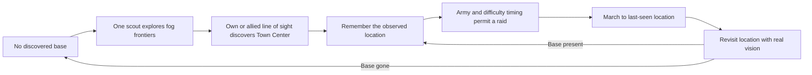

# AI exploration and remembered bases

AI commanders must **discover a Town Center through their normal team vision**
before planning a war party toward it. A hidden enemy base's current position,
health or destruction is not a target-selection input. All four difficulties use
this rule; difficulty changes production, decision intervals and raid timing.

A scout is the fastest available military unit. If there is no soldier, a village
with more than two workers can send one worker. Economy/builder reassignment does
not steal that worker back while it is exploring. A badly wounded scout near a
visible threat retreats toward its own settlement. Replacements are chosen if the
scout dies. Ordinary soldiers still defend themselves against visible enemies.

Scouting destinations are unexplored frontier points beside known ground, chosen
by distance and a deterministic tie break. The AI does not read enemy spawn points
or hidden Town Centers to choose that direction. A bounded eight-destination
history and retarget timer prevent repeatedly selecting the same failed waypoint.
Movement uses the same normal pathfinding/recovery rules as player-issued moves.

The AI remembers one last-observed settlement per opponent. If a base moves or is
destroyed while out of sight, memory stays at the old coordinates. Once the AI
revisits that visible location and finds it empty, it discards the memory and
scouts again. Allied current line of sight counts as a legitimate observation.
Multiple unseen replacement Town Centers are not granted automatically.

Resource searches also require explored tiles, so the AI cannot send gatherers
straight to undiscovered deposits. Friendly farms/drop-off buildings remain known.
There are no free resources, combat bonuses or difficulty-specific map reveals.

Implementation: `AIController` in `games/crownfall/world.h`, `World::ai`, vision
and nearest-resource filtering in `world.cpp`; profiles in `ai.h`. Memory is fixed
size:16 remembered settlements and eight recent scout destinations per controller.
It does not copy the world or allocate a second fog map. Tests check that moving
an undiscovered base does not change the first scout destination, undiscovered
bases receive no raid, remembered bases are not magically tracked, revisiting an
empty location clears memory, and discovered targets still respect raid timing.

Host diagnostics record scouting trips and changes in the number of remembered
enemy settlements, alongside existing production/raid events. These records do
not alter fog or grant command permissions.
