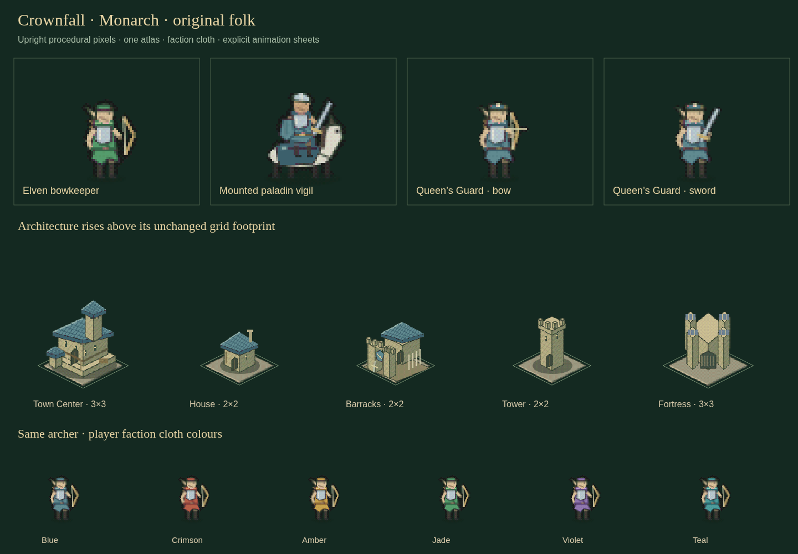
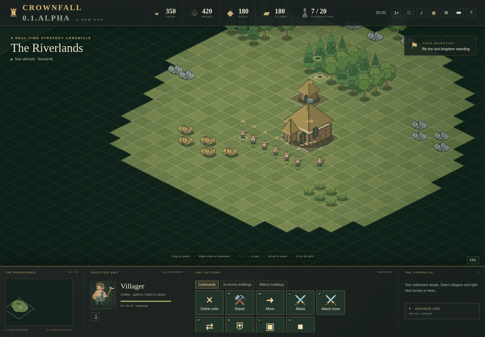

# Procedural Monarch artwork and original sound

Current update: [civilization architecture, spectator modes, age gates, 60 Hz tuning and platform policy](REALMS.md).


Every battlefield sprite comes from **one generated image**, `web/atlas.png`.
Monarch uses a 4096×9056 RGBA atlas: **141.5 MiB decoded**, down from the preceding
163.25 MiB. PNG decoding and GPU/browser copies can consume additional memory.
The favicon is a separate browser icon; UI vectors, flags and effects are local
lines/polygons, not downloaded art packs.

## Edit and regenerate

`web/art.js` contains all geometry. Use the optional development command:

```sh
python3 scripts/generate_atlas.py
```

A seeded generator draws polygons, rectangles, outlines, diagonal hatching and
stippled textures. A 4×4 Bayer threshold quantizes each red, green and blue channel
in steps of 12; alpha preserves transparent silhouettes. The committed PNG lets
players skip generation at startup. No image service, external art or Python
runtime is required to play.

```text
threshold = (bayer[x mod 4, y mod 4] / 16 - 0.5) * 12
channel = clamp(round((channel + threshold) / 12) * 12, 0, 255)
```

Terrain/resources use 128×128 source cells. Buildings use 128×192 with anchor
(64,160), three ages and ten race variants. Their bases retain exact 3×3 Town
Center/Fortress, 2×2 normal and 1×1 wall/resource occupancy. Roofs and tall trees
rise above their base. Canopies and resource tiles remain clickable.

Units have 64×48 packed source rectangles, anchor (32,44), and 9,056 total poses.
There are **eight quiet breathing frames**, shared by all classes; walking,
combat and work retain sixteen. Workers have 104 poses, ordinary soldiers 40,
and Queen's Guards 56 including the close-combat sword row. Classes are packed
only at legal ages. All humanoids use a uniform construction scale; goblins,
dwarves and hobbits use the same short-body transform. Mounts have separate
anatomy. No sword-cleaning, skull-dropping, flexing, praying, singing or other
class-specific idle performance remains.

The Monarch ranger design is original: a field tunic, split overskirt, collar,
bracers, boots and braid. It does not reuse the supplied image's pose or costume.
Male/female faces, skeletons, mounts and equipment share the same outline and
pixel density. Workers have no held weapon/tool at rest or while travelling.
Tools appear during chopping, mining, picking, construction/repair or fighting.
The Guard draws a sword only inside the native close-combat threshold; its bow
is the active weapon otherwise.

## Current sprite study



Tall resources retain the previous full-height foliage and single-tile roots:



## Owner colors and flags

Reserved semantic magenta shades in the generated atlas mark dye pixels only.
`factionFrame` maps those pixels to the owner's elected/reserved banner color;
skin, metal, hair, wood and stone remain protected. The same mechanism applies
to every unit and architecture accent, including damage/death rendering.
Frames are shared in a byte-bounded LRU cache: **at most 12 MiB RGBA and 1,024
entries**. Tall building frames count their actual byte size rather than being
mistaken for small unit frames. The cache is not allocated per entity.

Flags are not frozen in the PNG. `buildingFlag` draws a mast and six cloth strips
with a small analytic wind wave. Town Centers, other structures and small
farm pennants (walls have no flags in SilkRoad) use owner colors. Their movement is cosmetic and uploads no
animation packets. [Monarch ownership rules](MONARCH.md#banners-units-and-buildings).

## Animation and sheets

`web/motion.js` interpolates authoritative positions and chooses walk, attack,
work and idle. It never invents damage or resource gains. Paused simulations
freeze gameplay motion; work tools appear at contact. `damage.js` draws bounded
fires, structural holes and death ghosts with the correct owner colors.

In Studio's **Assets & animation** tool, choose race, age, unit, action and banner.
Preview, pause, scrub or export a transparent PNG sheet plus JSON frame map.
`CrownArt.spriteSheet()` uses sixteen columns of 64×64 export cells. The JSON
records action rows, frame rectangles, anchors and timing. Rebuild native and
WebAssembly templates after rule changes; browser artwork needs regeneration
and a reload. These remain planar sprites with mirrored facing, not 3D models.

Validation includes every legal pose/bounds, distinct frames, protected skin
colors, bounded cache, Guard sword/bow selection, Studio's actual PNG/JSON
exports, resource targeting and in-game flag drawing. Optional commands:

```sh
python3 tests/art_bounds_test.py
python3 tests/browser_animation_test.py
python3 tests/browser_assets_test.py
python3 tests/browser_monarch_test.py
```

## Original audio

`web/sound.js` synthesizes the music, ambience, selection/orders and work/combat
cues with Web Audio oscillators and noise. User interaction starts audio. Escape
settings control master, music and effects volume; preferences persist locally.
No commercial recordings, streaming service or external sound download is used.

## Goblin and Dwarf unit traits

Goblin heads have two pointed ears with a dark inner fold, drawn after headgear
so the tips remain visible. Dwarves have a broad forked beard, cheek whiskers
and a brass-bound central braid. The shared unit generator attaches these traits
to the head for every idle, walk, attack and work pose at every age. Facial hair
and skin use material colors rather than owner dye. Short-race scales and the
restored building sprites are unchanged.

## SilkRoad themes

The host chooses **Legacy** or **Silk-Road** building art. `atlas.png` and `atlas-legacy.png` share one layout, recorded with their SHA-256 hashes in `atlas-manifest.json`. Regenerate both with `scripts/generate_atlas.py`. Runtime does not regenerate the atlas on failure; restore missing files from the package. Uniform Imperial towers and flag-free tall walls apply to both themes. Gate41 has four directional frames; its base is3×1 or1×3. Modern attacks use wind-up/strike/recovery geometry. See [SilkRoad](SILKROAD.md).
