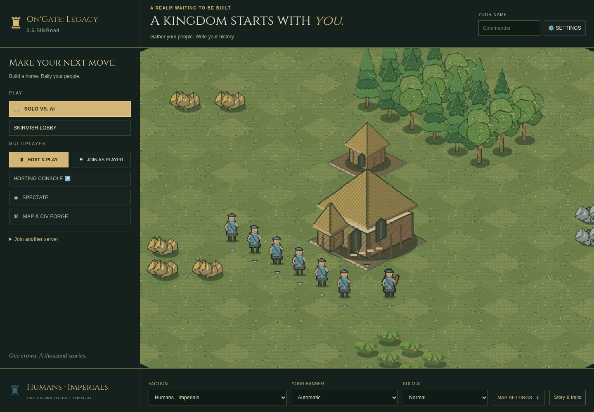
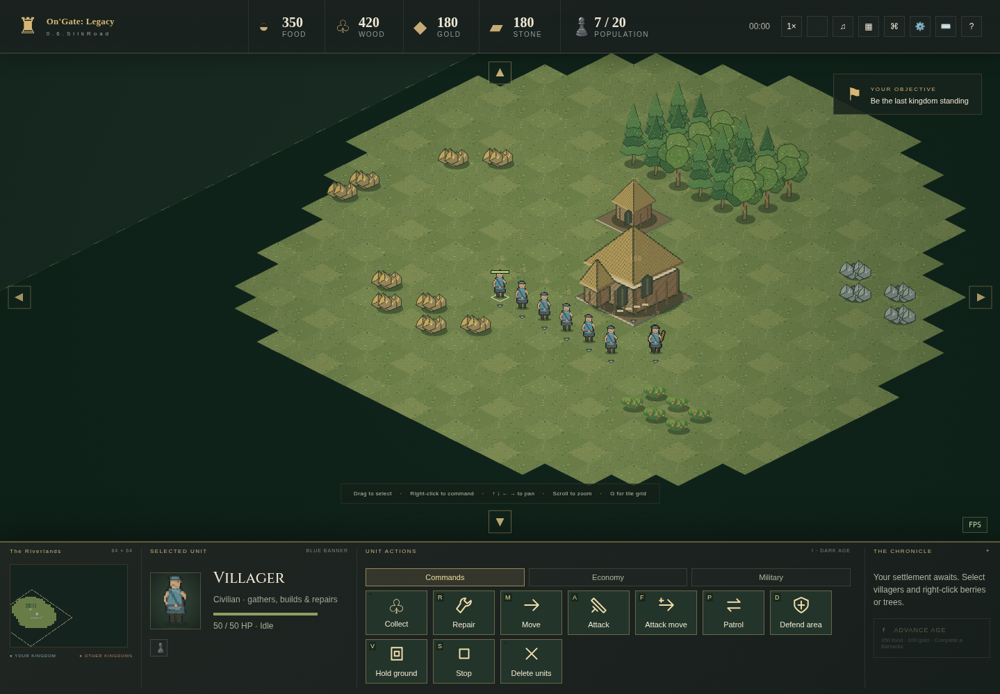
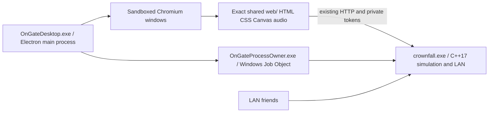

# On'Gate: Legacy — Electron desktop app

Download **OnGate-Legacy-Desktop-Windows-x64.zip**, choose **Extract All**, then run
**OnGate-Legacy-Desktop-Setup-x64.exe**. It installs for your Windows user without
an administrator prompt. The installer now lets you choose an empty destination
folder, including another drive. **Internet is required during setup** to download the
official Electron runtime (about151MiB); its SHA256 is verified before extraction.
Open **OnGate Legacy** from the Start menu afterward.
The game opens in its own application window, without a browser tab or terminal.
Close the game before reinstalling/updating. Windows may show an unsigned-app
warning: this development build has not been code-signed.

## The exact ongoing interface

The app bundles the **unchanged `web/` directory from the Windows-x64 release**.
Main menu, royal headings, animated civilization preview, fog, battlefield HUD,
command order, settings, audio, hotkeys and lobby panels use the same source as
Windows-x64/web. No simplified Godot layout is substituted. At the same viewport,
display scale and settings, the same responsive layout applies. Actual rendered
pixels can vary with GPU, display scaling and Chromium versions.

`UI-SHA256.json` records every shipped UI file. Packaging rejects a Windows-x64
archive whose UI differs from the current checkout. Simulation and multiplayer
are the exact native C++ `crownfall.exe` from that archive; no game rules were
rewritten for Electron. Future shared UI updates need one source change and a
repackage, rather than edits to separate desktop widgets.

The older Win32/Godot prototypes remain separate downloads with their original
interfaces and feature scopes. Android remains the existing Godot test edition.
This release does not change it.





## Requirements, controls and storage

- Windows10/11 x64. The installer downloads **Electron45.0.0**, including Chromium/Node and runtime
  DLLs. No manual WebView2, browser, Godot, Rust, Node, Python or compiler install
  is needed. Offline AI works without Internet after installation. If downloading
  fails or a checksum differs, setup stops; fix connectivity and rerun setup.
- Resize/maximize normally; **F11** toggles fullscreen. Wheel zoom controls the
  game camera; page zoom shortcuts are disabled. Existing keyboard, inset pan
  frame, audio and graphics settings remain available.
- Host consoles and spectator views open as additional app windows. Closing one
  leaves the main game running. Closing the main window asks for confirmation
  before stopping its local server and disconnecting hosted players.
- Program files: `%LOCALAPPDATA%\Programs\OnGateLegacyDesktop\`.
  Preferences, Chromium profile and engine data:
  `%LOCALAPPDATA%\OnGateLegacy\desktop-electron\`.
  Browser preferences are not automatically imported into this separate profile;
  game defaults are identical. Uninstall through Windows Installed Apps; saved
  data/preferences are retained in the separate profile folder.

## LAN play

Use **Host & Play** and **Join as Player** in the existing main menu. The same
AI/team/spectator/lobby options are available. To join another computer, enter
`http://HOST-LAN-IP:port` in the existing Join address field. It opens in the app.

The local native server uses TCP8080, trying8081–8099 if occupied. Its own stdout
readiness marker confirms startup; the app never attaches to a different process
already listening. Share the chosen address shown in the host console/game.
Allow the installed `resources\game\crownfall.exe` through Windows Firewall on
**private networks**. Both Wi-Fi and Ethernet work; guest Wi-Fi/client isolation
can block devices. Native LAN HTTP needs no Google STUN/TURN configuration.
Internet hosts must still be intentionally reachable; the separate browser WebRTC
flow retains its existing invitation/NAT requirements.

The local server stays alive while visiting a remote host and stops with the main
app. The new [Steam480 desktop guide](STEAM480-DESKTOP.md) explains the SDK-backed
relay mode: press Alt to reveal the native Steam480 menu. The package includes
OnGateSteam.exe, steam_api64.dll and480 configuration. The old Godot protocol is
separate and cannot join an Electron Steam lobby. Live account testing is pending.

## Architecture



Electron is used following the owner's request to use it when not using Tauri.
This is **an Electron build**, not Tauri/WebView2 and not a fully native Godot
renderer. Node runs only the desktop lifecycle code. The sandboxed game page has
`nodeIntegration=false`, `contextIsolation=true`, no preload and no privileged
IPC command bridge. Existing native token/owner/fog validation remains authoritative.
Top-level navigation/new windows allow HTTP(S), with no embedded-credential URLs.
Native permission prompts such as camera/microphone are denied; fullscreen works.

A small C++ process owner starts the bundled engine suspended, attaches a Windows
kill-on-close Job Object and resumes it. Electron holds a private stdin pipe open.
If Electron closes or crashes, that pipe breaks and the owner stops its own engine.
It never searches for/kills other servers by executable name. Logs are bounded to
64KiB during startup; no camera coordinates are added to network requests.

Electron bundles a browser runtime, so download size and baseline RAM are higher
than the earlier native prototypes. It preserves full UI/audio/editor presentation
and avoids maintaining a second UI. The simulation remains native C++.

## Build and update

Install Visual Studio2022 **Desktop development with C++**, CMake, Python3
(packaging only), and **NSIS3.11+**. Download the official Electron45.0.0 Windows-x64
ZIP from https://github.com/electron/electron/releases/tag/v45.0.0. The packager
verifies the pinned SHA256 from Electron's official `SHASUMS256.txt`.
No `npm install` is needed to package the prebuilt runtime. The published installer
embeds all game/UI files and retrieves the verified official runtime at install
time using Windows PowerShell. The runtime URL/hash are pinned in both the
packager and `packaging/desktop/fetch-electron.ps1`; update both together.

```powershell
cmake -S . -B build/electron-owner -A x64 -DONGATE_ELECTRON_DESKTOP=ON -DBUILD_TESTING=OFF
cmake --build build/electron-owner --config Release --target OnGateProcessOwner --parallel 2
python scripts/package-desktop.py --game-zip downloads/windows/OnGate-Legacy-Windows-x64.zip --owner-exe build/electron-owner/Release/OnGateProcessOwner.exe --electron-zip C:/SDK/electron-v45.0.0-win32-x64.zip --makensis 'C:/Program Files (x86)/NSIS/makensis.exe'
python tests/desktop_package_test.py
```

Build/update the normal Windows-x64 archive first whenever shared gameplay/UI
changes. Packaging copies its exact engine/UI into `resources/game/`, then bundles
`desktop/electron/main.cjs` and the C++ owner. Electron is editable JavaScript;
the build tool is Python, but Python never ships or runs in the game.
MinGW cross-builds use `cmake/windows-mingw.cmake`. No Linux/macOS release is made.
The staged development runtime trims unused locales; the installed official
runtime retains all its locales and graphics/software fallback DLLs. Notices ship
with both game and runtime. The outer ZIP contains the setup executable, readme,
source/runtime metadata and UI manifest. It is an **installer ZIP**, not a single
portable executable. Fetching the runtime during setup keeps Git downloads below
100MiB; once installed, game/runtime files are local.

For a completely offline installer, add `--offline` when packaging. That version
embeds the verified runtime and exceeds GitHub's100MiB Git file limit; distribute
it through a release asset or another file host. It is not the small published ZIP.

To develop with an installed Electron45 runtime, run `electron desktop/electron`
with `ONGATE_DESKTOP_GAME_ROOT` pointing at an extracted classic package containing
`OnGateProcessOwner.exe`. Packaged builds resolve game files internally.

## Validation and limits

`OnGateDesktop.exe --ui-self-test` waits for the real menu, canvas and fonts, checks
that the page cannot access Node, enters Host & Play, verifies host-token cloning
into the console popup, starts a match and verifies Collect first/Delete last.
It writes `desktop-self-test.json` and menu/battlefield screenshots in the profile,
then exits. This mode is for isolated development tests, not normal play.
`ONGATE_DESKTOP_TEST_PROFILE` can point those checks at a disposable directory.

Checks include Windows owner cross-compilation/imports, installer/archive CRC and
SHA256, every staged UI file against both source and classic ZIP, and exact engine
binary parity. A real Electron/Linux runtime plus virtual display exercises the
same main process and UI for development only; that is not Windows validation.
Windows CI installs silently, runs the actual app smoke test and verifies that
its bundled engine has stopped. Consult the CI result before treating it as passed.
Physical Windows/GPU/high-DPI/fullscreen/multi-device LAN testing remains pending.

## Portable edition

Download `OnGate-Legacy-Desktop-Portable-x64.zip`, extract the whole folder to a
writable location, and open **Play OnGate Portable.cmd**. It verifies/downloads
Electron on the first run, then launches the same OnGateDesktop.exe. No installer,
Start-menu shortcuts or registry entries are created. After preparation you can
run the EXE directly and copy the entire folder to another Windows10/11 x64 PC.
Keep `portable.flag`: it puts settings/data in `user-data/` beside the executable.
Initial preparation needs Internet; later offline AI needs no connection. Steam
mode requires the Steam client/Internet as usual. Keep DLLs/resources together.

Steam guide: [STEAM480-DESKTOP.md](STEAM480-DESKTOP.md). The complete SDK itself is
not redistributed. Public CI uses the compiled bridge/runtime in
`packaging/desktop/steam-runtime`; see that guide to rebuild against your private
SDK. The installer uninstalls only its recorded owned files, preserving unrelated
files added to a custom destination. The separate native Win32/Godot Windows
frontends are no longer being updated at the owner's request.
