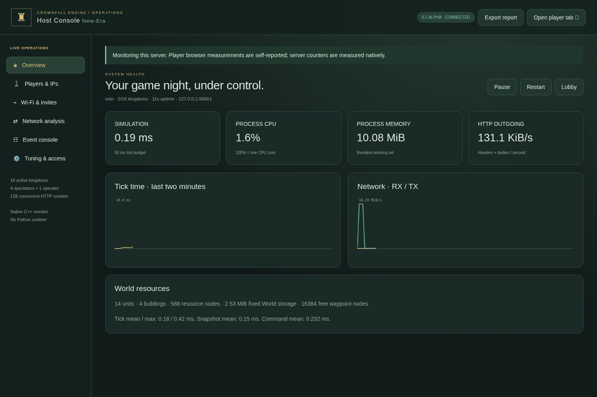

# Host Console, performance overlay and network analysis

Current update: [civilization architecture, spectator modes, age gates, 60 Hz tuning and platform policy](REALMS.md).

## Open an independent console

On Windows, extract the game ZIP and run **OnGate Legacy Host Console.cmd**. It opens native **Host Control**. Click **Start server**, then **Host Console** for `/host.html`, a separate browser dashboard from the game window. [Host Control/Wi-Fi guide](HOSTING.md) covers saved settings, invite links, UDP scanning, process logs and hardware limits. Choose **Host & Play** in the main menu for a playing host, or reserve the dedicated host seat and open a separate player tab. If a host session already exists, open its **Escape → Open host diagnostics** button; the new tab inherits that operator session. Other players cannot access private host diagnostics.

On any source platform, run the usual `crownfall` server, open `/host.html`, and reserve the host seat before players join. Engine Studio's **Open diagnostics** uses its local authoring authorization. Nothing is uploaded to a monitoring service.

## What you can inspect

- **Overview:** current, mean and maximum native tick time; process CPU; resident working set; outgoing HTTP rate; unit/building/resource counts; fixed world storage and free waypoint nodes. Charts retain the latest 120 one-second samples.
- **Wi-Fi & invites:** select a server adapter, copy an invite, check listener state and scan nearby UDP hosts. TCP gameplay works over the same Wi-Fi independently of discovery.
- **Players & IPs:** human/AI/observer/host seats, actual socket peer IPv4 addresses, readiness/defeat state and client-reported HTTP ping/FPS. Configure a waiting lobby, add AI, start once every human is ready, or kick an unwanted seat.
- **Network analysis:** total received/sent HTTP bytes, rates, open sockets, errors, timeouts and per-IP traffic. The transport supports 128 concurrent HTTP sockets. Peer history is bounded independently of match capacity.
- **Event console:** latest 256 timestamped player orders, sampled AI construction/deployment/raids, age changes, joins, administration, source-save and request-error events. Events have independent monotonic IDs and messages capped at 512 characters. AI activity is sampled every quarter game second outside the simulation tick; very short-lived entities can disappear between samples. Export report saves this bounded history, not an unlimited session log. Reports omit session tokens and edited file contents.
- **Tuning & access:** choose up to 60 scheduled player/spectator snapshots per second, edit up to 128 allowed and 128 blocked IPv4 addresses, and enable the allowlist. Save applies live and writes `data/server-policy.json`.

Process CPU uses **100% for one CPU core**, rather than a percentage of all installed cores. Memory is the native server process's resident working set, not total system memory, GPU allocation or every browser's memory. Browser ping/FPS are self-reported diagnostic hints. Process and transport counters are measured in C++.

The host can kick during a running match. Kicking invalidates that player's session and eliminates its kingdom; surviving allies continue playing. In the lobby it frees the seat. Blocking an IP additionally prevents new gameplay/join requests from that address. The current operator IP cannot be blocked through this UI. Several tabs or players behind a shared proxy/NAT may have the same IP; use a seat kick when an address is shared. The server records the socket peer, not a client-supplied forwarded-address header.

An allowlist controls access, not invitations: adding an IP does not connect that device or scan it. Share the server's reachable LAN address with players. There are **16 active human/AI kingdom seats, four independent spectators and one dedicated operator**. The IP lists and 128-socket transport limit are separate capacities. A full sixteen-computer physical LAN session has not been exercised here.

## In-game transparent overlay

Click **FPS** above the command deck, or enable **Escape → Performance overlay**. The translucent panel occupies the top-left map-label area. Its switch and frame-rate limit are saved in that browser. **Settings (top right) → Graphics & frame rate** (or Escape) offers presets through 200 FPS and a custom whole-number input from 1–1000. New profiles default to 60 FPS; valid saved profiles keep their existing cap. Invalid edits display an error and retain the previous limit.

The overlay shows actual rendered FPS, average rendering work, HTTP ping, order acknowledgment, order-to-authoritative-snapshot latency, API response-body usage and estimated request usage. Its client counters exclude TCP/IP overhead and initial image/CSS/script downloads. Use native Host Console traffic counters for all served HTTP headers and bodies, including assets. Neither counter is an Ethernet packet capture or an ICMP monitor.

A high FPS limit does not guarantee that FPS; the display, browser and hardware still bound it. Lowering the limit can reduce GPU/CPU work without changing the fixed 20-tick simulation. Audio, controls and tile-grid settings remain independent.

## Finding a movement delay

1. Enable the overlay and move one selected unit, then a larger formation.
2. Compare **Order ACK** and **Order → snapshot**. High ACK suggests connection or server request delay. A much higher snapshot figure suggests update delivery or encoding work.
3. Compare native tick/serialization times in the host console. The tick budget is 50 ms; sustained overruns indicate simulation load.
4. If server timings are low but FPS/render work is poor, inspect the browser/rendering load. Off-screen sprites are culled before sorting, and selection uses rendered unit positions plus indexed ID lookups.
5. Export the host report and record map size, player/AI count, army size, browser and the action that caused the problem. Rates and maxima are measurements for that run, not universal guarantees.

### Changes in this update

The original server could wait roughly one second for an incomplete request while holding the simulation thread. The new `http.cpp` incrementally reads requests and writes bounded chunks on nonblocking sockets, expires incomplete readers, limits concurrent connections and prioritizes ready gameplay commands. A slow peer no longer owns the simulation loop.

The browser uses incremental snapshots. The first response contains terrain and visible entities; later responses contain changed entities, removed IDs and fog only when it changes. Per-seat revisions detect missed/out-of-order baselines and trigger a full resynchronization. Ownership, fog filtering and team-only defeated-player vision still apply. Terrain and unexplored enemies are not exposed by the delta mechanism.

Scheduled player and observer updates both default to 20 Hz (both tunable through 60 Hz), waiting lobbies to 4 Hz and background game tabs to 1 Hz. A successful command wakes the snapshot scheduler immediately, without creating overlapping polling loops. Client commands are sent in click order through a bounded FIFO, so a delayed Move cannot arrive after its Shift-queued waypoints and erase them. Rendering follows authoritative positions; it does not invent a successful path before the server accepts an order.

In the local regression fixture, an incomplete connection previously delayed another response by about **975 ms**. A command with **32 incomplete-body connections** open completed in about **0.4 ms** on Linux and **0.8 ms** with the Windows executable under Wine. A paused player's full 128×128 snapshot was about **56 KB**; its unchanged delta was about **6.5 KB**. These are loopback test results, not claims about Wi-Fi ping or every match. See `tests/tools_test.py` and `docs/optimization-sample.json`.

## Edit the tools

Native counters and access policy live in `engine/diagnostics.*`; socket deadlines, buffers and queue limits are in `engine/http.*`. Native process controls live in `engine/host_windows.cpp`; UDP discovery in `engine/discovery.*`. Browser host code is `web/host.js` / `host.html`, styled by `tools.css`. Client sampling, render cap and state merging are in `web/perf.js`. Browser edits need a reload; native changes require rebuilding and restarting. Live tuning settings do not hot-patch C++ code.

`GET /api/diagnostics` and `POST /api/admin?action=policy|kick` require operator or local Studio authority. `POST /api/telemetry` accepts a joined client's bounded browser measurements. `GET /api/ping` is a lightweight HTTP probe. Normal game servers reject Studio file endpoints. This remains a trusted-LAN server with bearer sessions, not an Internet-hosting service or account-based anti-cheat system.

## Camera stays local

Camera coordinates/boxes are no longer uploaded by the game, including when old
preferences opted into camera-priority snapshots. Panning does not create extra
requests. Ordinary state deltas, commands and receive-only spectator feeds keep
their existing schedules. The debug overlay also shows retained ground-cache
sections and pixel memory. Read [panning optimization](PANNING.md) for the renderer,
memory bound, measurements and the full-snapshot bandwidth tradeoff.

## Receive-only spectator optimization

**Open spectator window** keeps the host console separate from a read-only viewer.
Native Host Control has a **Spectate** button. [HOSTING.md](HOSTING.md) explains
window behavior, seat limits and reconnects.

Spectators now receive chunked HTTP snapshots at a configurable 5–60 Hz (default 20 Hz) after a single
subscription, without routine polls, ping/telemetry POSTs or camera messages.
Ordinary viewers share one serialization per batch. Defeated commanders use
individual team-fog snapshots; they cannot subscribe to the omniscient data.
The native report exposes `spectatorStreams` and `spectatorBatches`. Observer
FPS/HTTP ping are not automatically uploaded; their local overlay identifies the
push connection. Overlay TX is estimated application traffic, excluding TCP ACKs.
A zero steady TX rate does not mean zero packets on the network.

`tests/spectator_stream_test.py` checks four viewers receiving three shared batches
with **three world serializations and zero extra HTTP requests**, plus role/fog
isolation, single-stream replacement, kicks, resets and connection cleanup. Browser
checks cover no recurring requests while snapshots advance, separate host/session
identity, reloads, full seats and revival from team-observer to commander. These
are local regression measurements, not a universal FPS, RAM or hardware guarantee.

Monarch host reports also expose `collisionPairs` and `collisionContacts` from the post-movement broad phase. [Multiplayer lifecycle, presets and million-body benchmark scope](MONARCH.md). No recurring spectator telemetry has been reintroduced.
