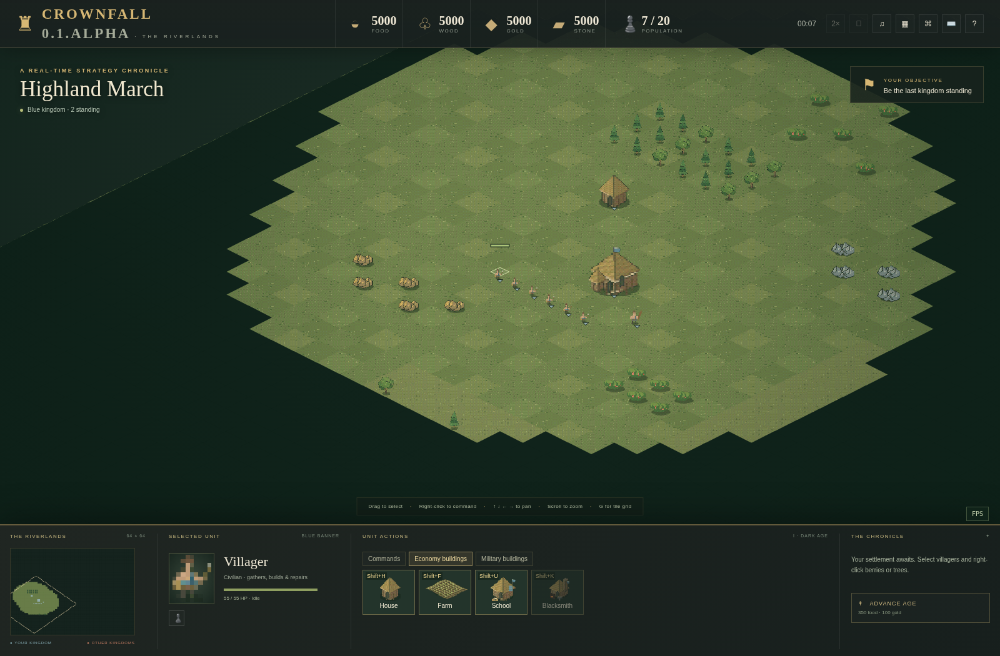
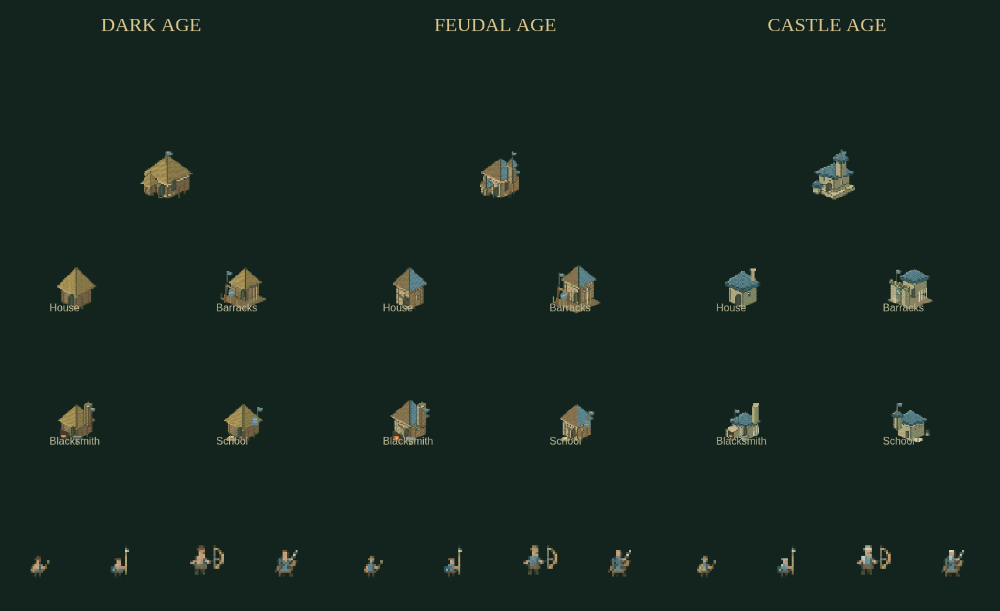

# Repairs, research and growing through the ages

These rules run in the shared C++ On'Gate: Legacy module. Windows, Linux, WebAssembly, LAN matches and Studio playtests use the same implementation.

## Villager action categories

Select villagers. **Commands** contains movement, combat, repair and deletion. **Economy buildings** contains House, Farm, School and Blacksmith. **Military buildings** contains Barracks, Archery Range, Stable and Watchtower. Selecting a School or Blacksmith replaces these categories with that building's research buttons.

Keyboard building shortcuts work from any category. **R** arms repair, **Shift+K** places a Blacksmith, and **Shift+U** places a School. All can be remapped. Older control profiles retain their custom shortcuts; a new action receives a free alternative chord when its default is already occupied.

## Repair a damaged building

Right-click your damaged, completed building with villagers, or choose **Commands → Repair** and click it. The target receives a **REPAIR** highlight. An unfinished structure receives construction work instead. Soldiers cannot repair; other players' structures cannot be repaired or paid for through your orders. Healthy Town Centers/towers retain their right-click garrison action.

Each working villager restores **16 HP per simulated second**, multiplied by its civilization's construction bonus. They must reach the structure first. Repairs consume the building's original resource types, at **half its construction cost per complete health bar restored**. For example, restoring half a 30-wood house costs 7.5 wood, charged as 8 whole wood.

Fractional prepaid amounts stay on the building. Several villagers share this accounting, so changing orders or adding workers does not repeatedly charge the rounding difference. A repair tick consumes resources before granting health. Work waits if the required resources are unavailable, and stops when the building is full or destroyed. Repairs never resurrect a destroyed building and do not replace construction or research queues.

## School and Blacksmith

**School:** available from the Feudal Age; costs **120 wood** and takes **22 seconds** to build. It improves the economy.

**Blacksmith:** requires the Feudal Age; costs **150 wood** and takes **25 seconds** to build. It improves soldiers. Both are on the Economy buildings tab.

Select the structure, then click a technology. The price is paid up front. A structure researches one technology at a time, and a kingdom cannot start the same technology simultaneously at another structure. Separate structures may research different technologies. All structures in the kingdom share completed upgrades, including units trained later.

| Technology | Effect per completed level | Level I: required age / cost / time | Level II: required age / cost / time |
|---|---|---|---|
| Forging | +2 attack for spearmen, archers and knights | Feudal / 100 food + 50 gold / 25 s | Castle / 180 food + 120 gold / 35 s |
| Armor | +1 armor for those soldiers | Feudal / 100 food + 50 gold / 25 s | Castle / 180 food + 100 gold / 35 s |
| Hand Tools | +20% villager gathering rate | Feudal / 75 food + 50 wood / 20 s | Castle / 150 food + 80 wood + 50 gold / 30 s |
| Wheelbarrow | +12% villager walking speed | Feudal / 100 food + 40 wood / 25 s | Castle / 180 food + 75 wood + 75 gold / 35 s |

Two completed levels give +4 attack, +2 armor, +40% gathering, or +24% villager walking speed respectively. Gathering/walking modifiers multiply the civilization bonus. Armor reduces each hit but never below one damage. Forging/armor apply to every military class in A New Era and do not upgrade civilian attacks or tower/Town Center weapons.

The queue shows research progress. Pause freezes it; game speed scales it. Destroying or razing a research structure cancels its current research without a refund, and allows the technology to be started at another structure. Completed upgrades survive the loss of the structure. Technology levels and research queues remain private to the commander and authorized observers.

## Dark → Feudal → Castle

A new kingdom starts in the **Dark Age**. Its adults have bare upper bodies, basic tools and simple equipment; buildings use mud, timber and thatch. Feudal villagers gain tunics and practical clothing, soldiers gain better protection, and settlements become larger timber buildings. Castle uses the prior stone/roof style, with added detail, armor and distinct building silhouettes.

Age advancement updates existing houses, structures and living units as well as newly produced ones. Dead bodies keep the appearance of their age at death. Blacksmith research changes combat values; age advancement controls the architectural/clothing style. Civilization Designer includes an age preview selector.

Town Centers and Fortresses occupy **3 × 3 logical tiles** and render larger at every age. Their default rally flag is three coordinates forward on each axis. Exit, deposit, repair, garrison and melee ranges account for the larger footprint. Houses, farms, barracks, ranges, stables, towers, schools and blacksmiths occupy 2 × 2 tiles; walls occupy one. Natural resources are centered in unique one-tile cells. Barracks have a separate gate, training yard and weapon racks, rather than a housing silhouette.

## Gather and explore

A villager can gather by right-clicking a resource sprite **or its ground tile**. The native simulation validates known/visible resource targets; this does not reveal unexplored deposits.

Generated maps contain neutral forest, berry, gold and stone patches away from the starting settlements. Generation is deterministic for a seed, map style and size. On authored maps, **Automatic resources** enables both starting supplies and neutral patches. Turn it off for complete hand placement. The map editor shows each start's 3 × 3 Town Center footprint and prevents new resource brush strokes inside it.

## Change these rules in your own project

- `games/crownfall/catalog.h`: building prices, ages, HP, footprints and technology costs/durations/requirements.
- `games/crownfall/world.*`: repair rate/accounting, upgrade effects, pathing, occupancy and resource generation.
- `web/game.js`, `controls.js`: categories, research buttons and shortcuts.
- `web/art.js`: age-specific geometry, palettes, poses and frame layout. Regenerate `atlas.png` after changing its generator.

Maps and civilization bonuses remain compatible with the existing content format. The original resource kind IDs 11–14 are unchanged; new building IDs are appended as Blacksmith 15 and School 16. Rebuild each native/Web runtime template after C++ changes, then export through Studio. See [EXPORTS.md](EXPORTS.md) and [NEW_GAMES.md](NEW_GAMES.md).

The fantasy race templates, military roster and Fortress rules are documented in [A New Era](NEW_ERA.md).

Screenshots from earlier milestones illustrate the editor/roster layouts; the current shared uniforms and shared idle are shown in [ART.md](ART.md).

SilkRoad: [queued construction, protected Town Centers, foundation refunds, Gates and Castle Swordsmanship](SILKROAD.md).
