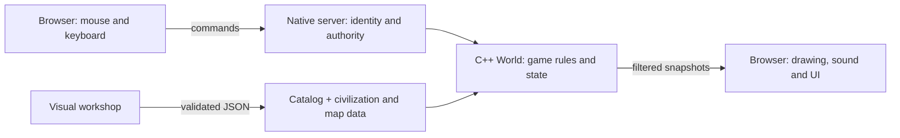

# The engine, explained simply

For a stack-to-structure map and edit/rebuild matrix, read [Technology and core structures](TECHNOLOGY.md).

## Start with a village made of numbers

A villager on the screen is not a picture that thinks. The engine stores a small record: its type, owner, position, health, order, carried resources and a few timers. The renderer turns those numbers into a picture.

A house is another record. Most of the time it has no work to do. It does not get its own thread, copy of the map, copy of the artwork, or list of people living inside it.

A **definition** is the shared recipe for a type. For example, all ordinary spearmen read the same base health, movement speed, damage, cost and training time from `games/crownfall/catalog.h`. Each spearman only stores its changing state. A civilization adds multipliers without duplicating the recipe per unit.

## The four useful boxes

- **Simulation:** `games/crownfall/world.h` and `games/crownfall/world.cpp`. The actual game, without any browser or socket code.
- **Platform adapter:** `engine/main.cpp`, `engine/network.*` and `engine/http.*` own the native clock and sockets. `games/crownfall/application.cpp` owns RTS sessions, lobby and gameplay routes. `engine/web_main.cpp` hosts the same module in a browser worker.
- **Presentation:** `web/game.js`, `web/motion.js`, `web/controls.js`, `web/art.js`, `web/sound.js` and the stylesheet. Input, graphics, synthesized audio and readable controls.
- **Content:** `games/crownfall/models.h`, `games/crownfall/content.*`, and `web/workshop.js`. Civilization and map data, validation, persistence and editing.

You can instantiate `World` in a test, tell it to advance, and inspect its result without opening a browser. That is how the native tests and benchmark run.

## A tick is one small step

The game advances in fixed steps of **0.05 seconds**, or **20 ticks per simulated second**. A fast or slow screen refresh does not change gathering speed or damage. The server measures real elapsed time and runs the required number of steps. Pause stops steps; changing speed changes how quickly simulated time advances.

Each step roughly does this:

1. Rebuild building occupancy and spatial buckets from live entities.
2. Advance age research.
3. Update construction, production, carried resources, movement and attacks.
4. Separate overlapping mobile units using nearby tile buckets.
5. Refresh line-of-sight circles periodically and keep explored tiles remembered.
6. Let each enabled AI make strategic decisions at its own difficulty interval (0.5–4 seconds). See [AI.md](AI.md) for worker targets, research priorities and raid timing.

Only the native process changes authoritative state. The browser asks it to move a villager; the browser does not decide whether a knight is free or an enemy is dead.

There is one simulation thread. The HTTP transport shares it using bounded nonblocking socket reads/writes, so incomplete requests and slow receivers do not hold the simulation inside a blocking read. Connection limits, deadlines and write chunks bound network work. Ready commands take priority over queued snapshot requests. See [DIAGNOSTICS.md](DIAGNOSTICS.md).

## Orders are small instructions

`World::command` accepts an owner, action, selected IDs and a payload such as a destination or target. The server derives the owner from a session token. A browser cannot choose another owner in the command payload.

Supported actions include `move`, `interact`, `attackmove`, `patrol`, `defend`, `hold`, `stop`, `queue_move`, `rally`, `spawninside`, `ungarrison`, `delete`, `raze`, `build`, `train` and `age`. `interact` picks the sensible action: a villager gathers a resource, helps an unfinished friendly building, or attacks an enemy. Orders validate ownership, costs, age requirements and visibility before use. Operator and spectator seats cannot send gameplay commands.

For new mechanics, add validation here and behavior in `World::update`. Add a meaningful native scenario before wiring a button into the renderer.

## How gathering works

A worker walks to a deposit, gathers up to ten resource units, walks back to a completed friendly Town Center, and deposits its load. Resources only enter the player stockpile when delivered. If you change a worker from wood to berries, it delivers the old wood before collecting food; it cannot turn one resource into another.

Trees, berries and mineral deposits deplete. Farms provide renewable food. Civilization gathering bonuses change how quickly work accumulates. This is a deliberately small economy; there are no markets, trade carts, hunting, livestock, mills or lumber camps yet.

## How construction and training work

Placing a building checks the visible tile, terrain, spacing, selected builders, age and resources. The cost is paid once. Assigned villagers must reach it and supply work until construction is complete. Additional builders contribute additional work.

Production buildings hold a fixed eight-entry queue. Cost is paid when queued. A completed unit needs population space and a legal spawn tile. If blocked or full, production waits instead of pretending a unit appeared. A house adds five population slots; a Town Center adds fifteen; normal play caps at 120 per kingdom.

The benchmark creates extra entities directly through the engine API to measure scale. It does not claim that the normal game lets one player train a thousand people.

## How movement works

The map is a logical grid, from 48×48 to 128×128, including rectangular sizes. Water and building footprints block movement. Bridges and earth are walkable. Units have continuous positions between tiles.

Movement first tries a straight route. If terrain or a building interrupts it, a fixed-buffer breadth-first grid search finds a next waypoint. Diagonal steps cannot cut through blocked corners. Searches are limited to **16 per tick**, so a mass order cannot trigger unlimited path work in one frame. Waiting units retry. Waypoints are cached, and movement orders add small formation offsets.

Soft circle separation reduces mobile-unit overlap. It is not a complete crowd-navigation system; dense bridge traffic can still bunch up, and a large obstructed army may take time to receive routes. A future upgrade could add shared flow fields, hierarchical paths and better formation destinations.

## How fighting and winning work

Units look for visible enemies nearby. The tile buckets narrow the search to nearby objects. An attack needs range and a ready cooldown. Damage is applied by the simulation; arrows and floating numbers in the browser are visual feedback.

Spearmen deal extra damage to knights. Archers do less damage to buildings. Advancing ages increases damage. Civilization modifiers can change health, damage and speed.

Destroying a kingdom's last Town Center eliminates that kingdom and removes its remaining entities. The match ends when every surviving kingdom belongs to the same side: one independent kingdom, or one allied team. That matters in a sixteen-player free-for-all: the first eliminated player does not end everyone else's game.

## Fog is a rule, not just dark paint

Each player has separate visible and explored byte arrays. Friendly units and buildings reveal circles. The server filters snapshots: players receive their own entities, visible opponents and explored resource objects. Other players' private resources, population and queues are omitted or zeroed. Attack targets cannot be followed through lost visibility.

Spectators and the dedicated operator intentionally receive an omniscient snapshot. This is useful for watching and administration; it is not tournament anti-cheat. Fog currently uses distance circles rather than terrain-height or wall occlusion.

## Memory: why thousands of objects fit

There are **8,192 reusable entity slots**. One entity record measured **180 bytes** in the tested Linux build. Position, health, timers, order and the eight-entry production queue live together in that record.

A slot can be reused after death or depletion. IDs include a generation: an old selection cannot silently become a newly spawned unit in the same slot. Shared definitions and artwork stay shared.

The fixed `World` object measured **2,652,224 bytes**, about **2.53 MiB**, including the reserved entity pool, sixteen players' fog / fallen-unit sight grids, occupancy, bucket links, content handles and the shared pending-route pool. This is reserved capacity, so an empty world already pays most of that fixed cost. Strings and external content, HTTP buffers, JSON snapshots, the executable and browser are additional memory.

There is no zero-RAM simulation. The useful promise is bounded storage, reuse and measurement. The supplied benchmark ran 1,000 units and 2,500 houses with no heap allocations in its measured tick loops. Other paths, such as JSON serialization, mod loading, AI command construction and notices, can allocate. See [the measured performance guide](PERFORMANCE.md).

## Make a different game

For a first change, edit a cost in `catalog.h`, rebuild, and play. Keep the UI's cost labels synchronized if you change the roster or prices. For a data-only change, use the civilization designer; no compile is needed.

For a larger change, preserve the boundary: C++ owns rules, commands express intent, and the browser visualizes snapshots. For example, a survival game could replace conquest with a night timer, add hunger to `Entity`, add a food-consumption update, and reuse movement, resources, the map forge and networking. This engine is an RTS foundation, not a universal Unity-like editor or arbitrary game scripting runtime.

A new unit type needs the catalog, kind handling, production validation, renderer labels, atlas frame mapping and tests updated together. See [MODDING.md](MODDING.md) for a practical checklist.

## Reference reading

The openage documentation was consulted for its separation of simulation from presentation/networking, entity components, commands and data-driven design:

- [Game simulation architecture](https://github.com/SFTtech/openage/blob/master/doc/code/game_simulation/README.md)
- [Built-in components](https://github.com/SFTtech/openage/blob/master/doc/code/game_simulation/components.md)
- [Movement systems](https://github.com/SFTtech/openage/blob/master/doc/code/game_simulation/systems.md)

On'Gate: Legacy uses a simpler fixed-step world and bounded entity pool. It does not implement openage's nyan system, curve-based component history, event-driven simulation, asset conversion or AoE compatibility. No openage source or assets were incorporated.

## Multiple computers and locked teams

`World::controllers[owner]` holds an `AIController` for every potential kingdom: enabled, difficulty, think/raid clocks and raid count. `ai(owner)` makes decisions using only that kingdom’s economy and entities. `tick()` visits all enabled undefeated controllers at their own profile’s decision interval. No controller needs another world, entity pool, thread or network client. Work still grows as more planners and armies become active; it is not free CPU work.

`World::teams` stores zero for independent kingdoms or a matching nonzero number for allies. Use `allied(a,b)` / `enemies(a,b)` for every combat or strategic target test rather than comparing owner IDs. Shared vision merges each team into its lowest-numbered member’s existing fog grid and copies the union to teammates. This uses no new per-team fog arrays. Ownership and private economy remain separate. Victory returns a representative kingdom ID; everyone allied with that ID wins. Teams are set before start and locked during play.

The server’s lobby explicitly distinguishes occupied human seats (session token) from occupied computer seats (AI flag). Both count against capacity. At start it compacts all roster fields together—token, name, civilization, AI flag, difficulty, team and readiness—then configures the world. Local skirmish grants the player in slot zero administrative control; LAN keeps the separate operator in seat 14. See [SERVER.md](SERVER.md) for API examples and [AI.md](AI.md) for customization.

## Native operating-system adapter

`engine/network.h` and `network.cpp` isolate socket handles, initialization, closure, timeouts, readiness checks and LAN address discovery. Windows uses 64-bit `SOCKET` handles, `WSAStartup`/`WSACleanup`, `closesocket`, millisecond timeout values and IP Helper. Linux uses POSIX descriptors, `close`, `timeval`, `getifaddrs` and SIGPIPE handling. Do not cast Windows sockets to `int`: that can truncate a handle. `SocketGuard` releases the listener/client before the networking runtime shuts down.

`ContentStore::save` uses Windows `MoveFileExW` with replace semantics for repeated registry saves; POSIX uses filesystem rename. The simulation remains independent of sockets and Windows headers. CMake builds both adapters from the same sources, links the Windows system libraries and static C++ runtime, and reserves a 16 MiB Windows stack for the bounded world/pathfinding buffers. See [WINDOWS.md](WINDOWS.md) for portable packages and compiler setup.

## Alpha routes, shelter and presentation

Each mobile entity stores its current destination plus indices into a shared fixed waypoint pool. Think of the pool as numbered reusable slips of paper: a unit holds the first and last slip numbers, and each slip points to the next. Finishing or canceling a route returns slips to the free list. There are 16 pending points per unit and 16,384 slips for the whole match. A house does not reserve a private sixteen-point array. Ordinary orders replace pending movement; `queue_move` appends it. Slot reuse and elimination return pending nodes.

A sheltered unit keeps its existing entity record and population cost; `garrison` identifies its host. Stored units skip spatial buckets, movement, combat targeting and vision. Production can wait in a Town Center. Deployment chooses free ground toward the host's rally flag and restores a move/gather order. `World::eliminate` handles surrender and final-Town-Center defeat together, then recalculates sight and victory. A defeated LAN client's owner ID remains intact, so it receives team fog rather than the full-observer `json(-1)` view.

`web/motion.js` smooths displayed positions and chooses atlas poses from actual movement, task proximity and attack cooldowns. Its state never moves an authoritative unit. `web/controls.js` validates configurable bindings and camera settings; game buttons and shortcuts call the same command functions. Read [GAMEPLAY.md](GAMEPLAY.md) before changing order semantics, and run the native and refinement tests afterward.

## Incremental snapshots and recent death sight

The regular `json(viewer)` path remains a complete filtered snapshot for tools/tests. A browser stream also supplies a `SnapshotCursor`: per-slot fingerprints and generation IDs, a revision, fog fingerprint and death-event sequence. Static terrain is sent once, unchanged entities/fog are omitted, and removed IDs explicitly leave the browser cache. A missed baseline causes a full resynchronization. Cursors are separate from `World`, bounded per session, and allocated on the heap in the server.

`recordDeath` writes a bounded authoritative tombstone with the viewers who could see the death. This prevents a unit merely leaving fog from receiving a fake death animation. A separate per-player byte grid preserves fallen mobile units' sight for five seconds, updated at quarter-second vision refreshes. Each cell stores a small remaining lifetime, not a particle object or a new unit. Team merging includes those circles. The renderer has at most 128 temporary corpse/collapse effects; visual limits do not limit authoritative sight grace. See [GAMEPLAY.md](GAMEPLAY.md).

## Reuse the engine

Game rules live in `games/`; platform and authoring services live in `engine/`. The independent Orbit module exercises the same application interface. See [NEW_GAMES.md](NEW_GAMES.md) for the module contract and [EXPORTS.md](EXPORTS.md) for Windows, Linux and WebAssembly exports.

## Repairs, research, ages and footprints

`Entity` is 196 bytes in the current GNU x64 build (including stall recovery state). Buildings retain four fractional repair balances so workers share cumulative resource rounding. Players have fixed-size technology level/pending arrays. Research reuses the building training clock; no independent timer thread or heap object is created. Repair is order 10, appended after existing orders. New building kinds are appended after existing resources. Catalog flags replace broad resource/building ID ranges.

Age is serialized with each visible owned entity and included in stream fingerprints, so advancement updates unchanged structures and units. Death events keep age-at-death separately from cosmetic elapsed time. Town Center occupancy, exit candidates and task/combat ranges use the larger 3×3 footprint. Build collision tests use the snapped tile center. See [ECONOMY.md](ECONOMY.md).

Fantasy rules and additions live in the On'Gate: Legacy module: [NEW_ERA.md](NEW_ERA.md). `races.h` owns legal rosters and default peoples, while the generic engine still exports independent game modules. `isUnit` / `isBuilding` / `isResource` replace numeric class ranges; new infantry IDs appear after buildings. Garrison volleys are cached during recalculation, and support-source flags avoid aura queries when a kingdom has no deployed allied bard or warlord.

## Monarch engine additions

`engine/spatial_grid.h` enumerates unique neighboring-cell pairs without bucket caps; `engine/crowd.h` provides separately benchmarked equal-radius swept-disc physics for up to one million bodies. The RTS uses the same pair iterator after movement, but retains its bounded 8,192-entity world and full AI/fog/network costs. Do not equate the physics benchmark with one million complete RTS units. [API, measurements and limits](MONARCH.md#legacy-hardware-and-measured-limits).

Playing-host ownership, color reservations and session departure are in the game adapter, not the generic transport or physics engine. Exported projects include these source files and matching runtime templates.
