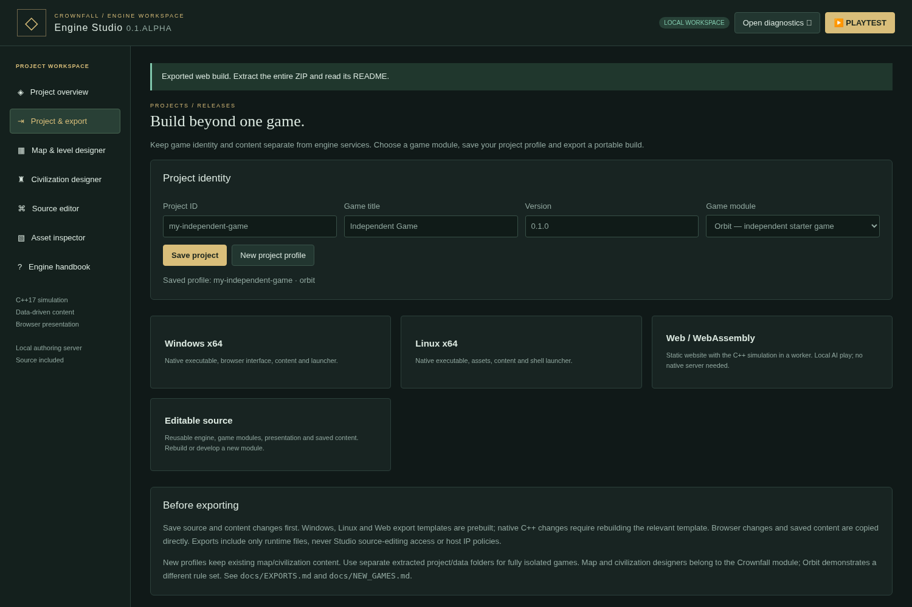

# Export a game from Engine Studio

An export is a **new package for players**. Studio stays in your development folder. The game package contains the selected module, presentation and saved content; it does not grant source-editing access.

## Export without installing a compiler

1. Open **CrownfallStudio.exe** from the fully extracted Engine Studio ZIP.
2. Choose **Project & export**.
3. Set a lowercase **Project ID**, a game title and a version. Choose **On'Gate: Legacy** for a strategy game or **Orbit** for the small independent starter.
4. Click **Save project**. Save any map, civilization or browser-source edits too.
5. Click **Windows x64**, **Web / WebAssembly**, or **Editable source**. Studio downloads a ZIP.
6. Extract the whole ZIP. Follow its README.

The shipped Studio includes prebuilt runtime templates for both playable targets. Missing templates disable their export buttons. The export service is native C++; exporting does not invoke Python, a shell or an external compressor.

| Target | How players run it | Simulation | Multiplayer |
|---|---|---|---|
| Windows x64 | `Play.cmd`, then browser at `http://127.0.0.1:8080` | Native C++ executable | On'Gate: Legacy LAN, 16 active kingdoms |
| Web | Upload the extracted folder to a static HTTP(S) host; open its `index.html` | Same C++ game code compiled to WebAssembly, in a dedicated worker | Local AI and WebRTC rooms through manual invitations; no native LAN TCP server |
| Editable source | Open in Studio or an ordinary editor; build using the guides | Engine services and game modules included | Depends on selected module |

The Windows executable is x64 and includes its C++ runtime. These packages use browser graphics/audio; the native binaries are engine hosts rather than stand-alone native renderers. macOS, ARM and mobile native packages are not export targets here.

Web exports work on static hosts and in subdirectories. They need HTTP(S), not double-clicked `file://` pages. To test one locally you can use any static file server, for example the optional development command `python -m http.server 8000`. No gameplay API server, Python interpreter or native engine process is required by the deployed website. Browser background-tab throttling can slow the local simulation. The Web runtime starts with a 32 MiB Wasm heap and may grow up to 256 MiB; browser graphics/assets use additional memory.

Native On'Gate: Legacy exports retain their host diagnostics page; Windows exports also include **CrownfallHost.exe** and **Host LAN.cmd** when the matching Host Control template is installed. [Wi-Fi hosting instructions](HOSTING.md). Source authoring is excluded. Web map/civilization saves use IndexedDB, separated by project ID. Clearing site data removes them. Export important designs as JSON. Web saves and native saves are separate. LAN administration and source authoring stay in native Studio/host builds. Orbit is a single-player starter and has no RTS lobby or civilization designer.



## Understand templates before updating C++

The exporter copies precompiled runtime files from **`project/export-templates/`**. This makes ordinary content/browser edits and exports work without a compiler.

Changing a `.cpp` or `.h` file does **not** change a precompiled executable or `.wasm` file. Rebuild each affected platform, install its new template, then export again. The project version is your game's release label; it does not silently change the engine protocol version. Record the source commit and your module changes for each release.

### Windows

Install Visual Studio 2022 with **Desktop development with C++**, a Windows SDK and CMake. From the Studio `project/` folder in Developer PowerShell:

```powershell
cmake -S . -B build/windows -G "Visual Studio 17 2022" -A x64
cmake --build build/windows --config Release --parallel 2
ctest --test-dir build/windows -C Release --output-on-failure
python scripts/prepare-exports.py --windows build/windows/Release/crownfall.exe --host build/windows/Release/CrownfallHost.exe
```

Python 3 is needed only for the optional development scripts/tests. You can instead manually copy the rebuilt executable to `export-templates/windows/crownfall.exe`. Stop Studio before replacing its own `../crownfall.exe` if you want its playtest to use the changed engine too.

### Retired platforms

Linux and macOS releases/exports are retired. Older milestone packages remain
available, but no Linux runtime template is included in current Studio ZIPs.
Unix source builds are for development/testing and compiling the Web demo.

### Web

Install and activate the official [Emscripten SDK](https://emscripten.org/docs/getting_started/downloads.html). It includes the C++/WebAssembly compiler and the development tools it needs. Then, from an activated SDK terminal:

```sh
emcmake cmake -S . -B build/web -DCMAKE_BUILD_TYPE=Release -DBUILD_TESTING=OFF
cmake --build build/web --parallel 2
python3 scripts/prepare-exports.py --web build/web
```

On Windows use `python` instead of `python3` if needed. Copy **both** `engine.js` and `engine.wasm` to `export-templates/web/`; mismatched pairs can fail to start. No browser C++ compiler is embedded in Studio.

To package a Studio with refreshed templates, install both first, build the ordinary Windows ZIP, then run `scripts/package-studio.py` as described in [STUDIO.md](STUDIO.md). Keep compiled templates out of source control; distribute them inside the Studio ZIP. The workflow compiles Web on an Ubuntu development runner and Windows on Windows; it produces no Linux release.

## What exports contain

Project identity is stored in `data/game-project.json` while authoring, and in the export's `game-project.json`. Saved RTS content is copied from `data/content.json`. Runtime exports include only the module's declared presentation folder, runtime template, content, launch instructions and applicable licenses. Source exports include engine services, both starter modules, sources, docs and saved content. IP policy, editor backups, session tokens and live match state are not exported.

A new profile changes release identity and selected module; it retains the workspace's saved content. For separate games, use separate project and data folders, or extract a fresh Studio copy. Back up source and content before updating Studio itself.

The fantasy race templates, military roster and Fortress rules are documented in [A New Era](NEW_ERA.md).
