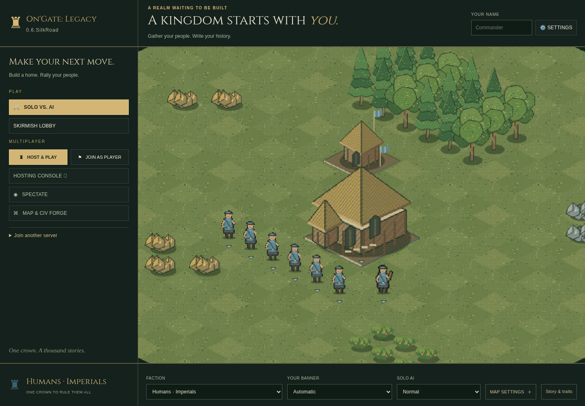
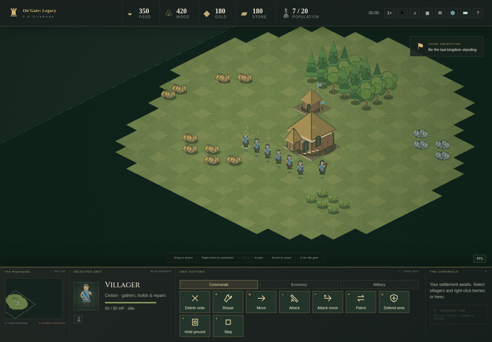
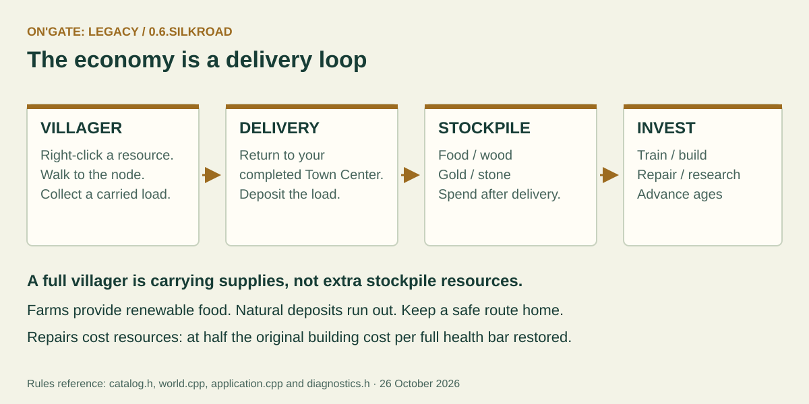
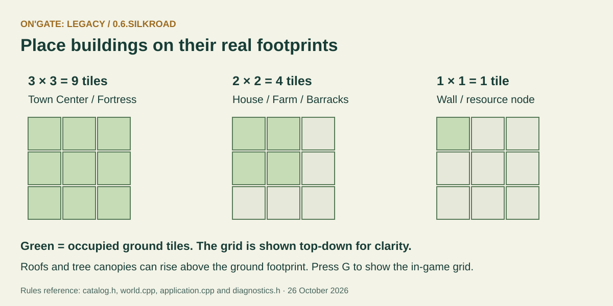
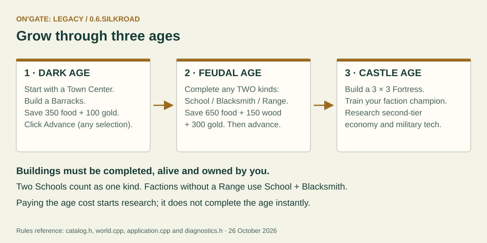
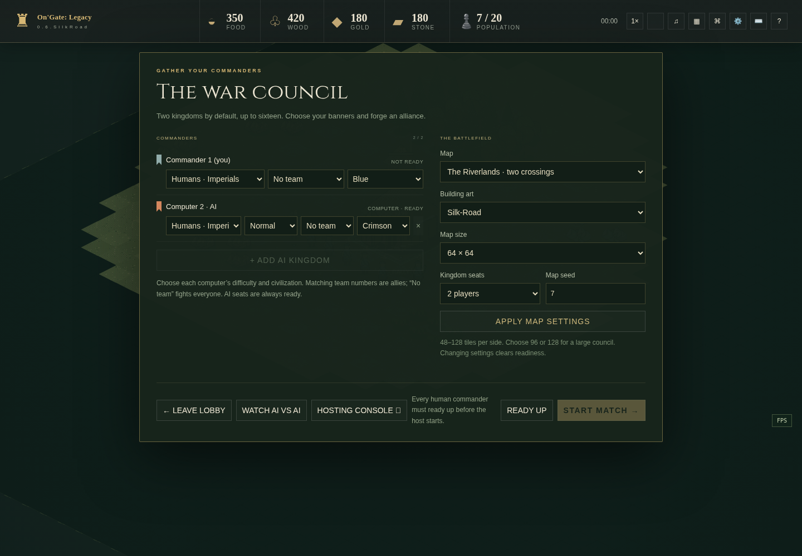
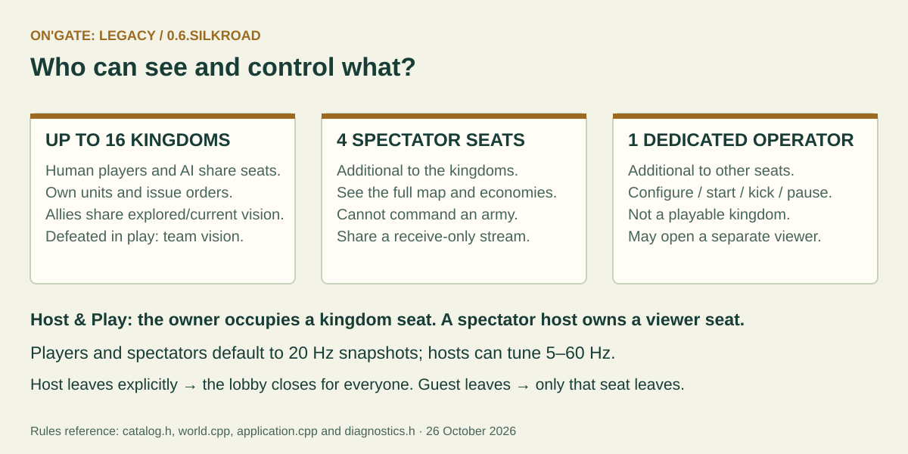
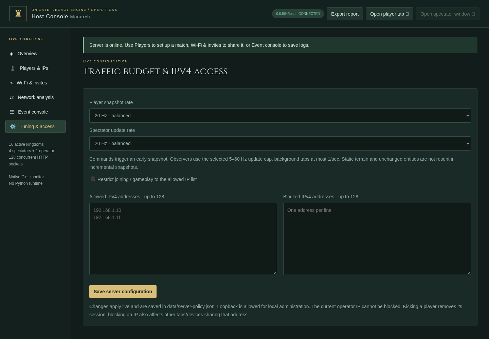
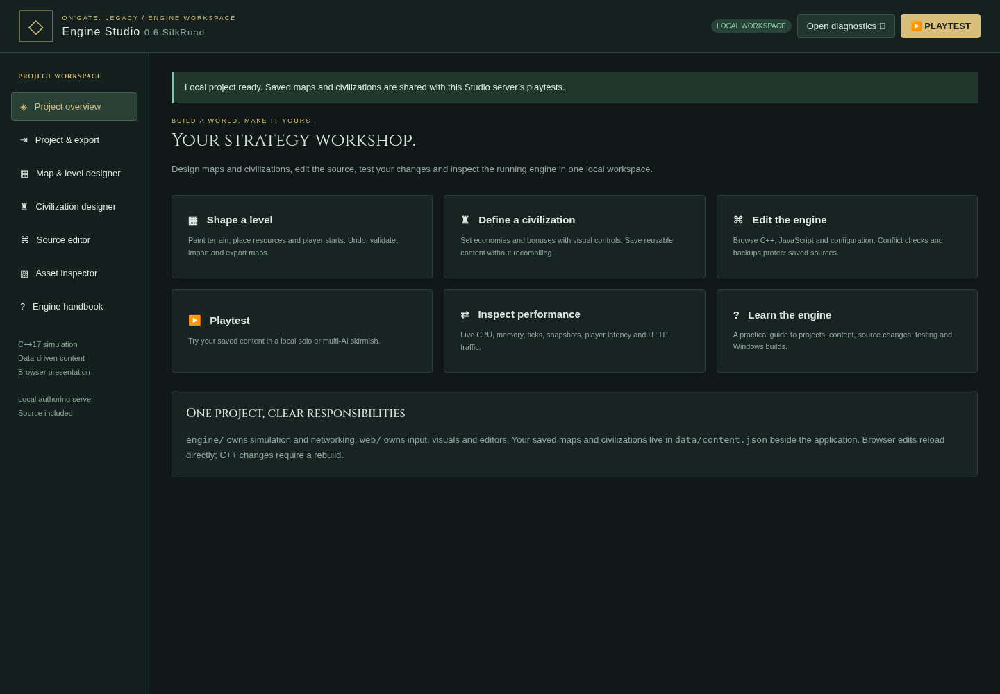
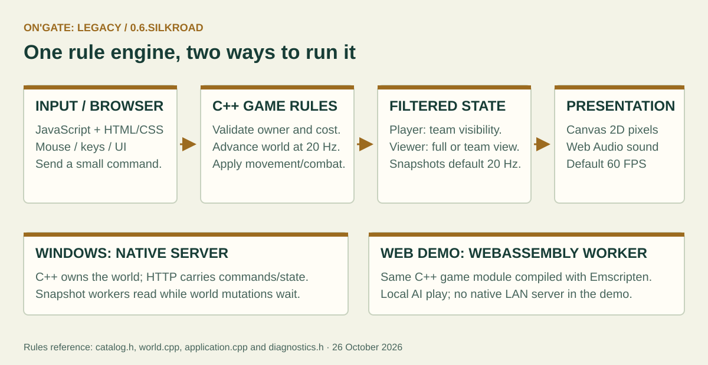

# On'Gate: Legacy field guide · 0.6.SilkRoad

A practical handbook for your first kingdom, a LAN evening with friends, and your first mod. Screenshots show the current game; diagrams explain the rules rather than promise an exact battle outcome. Updated **24 October 2026**.

**Other formats:** [Offline HTML handbook](field-guide.html) · [Printable handbook with technology appendix (PDF)](OnGate-Legacy-Handbook.pdf).

**Choose your route:** [Play your first match](#1-start-your-first-kingdom) · [Learn the screen](#2-read-the-screen) · [Orders and shortcuts](#3-select-and-command) · [Build and research](#4-grow-your-settlement) · [Choose a people](#5-choose-your-people) · [Host with friends](#6-play-with-friends-or-watch-ai) · [Create content](#7-make-a-map-or-civilization) · [Understand the technology](TECHNOLOGY.md).

**New in this build:** [SilkRoad construction, art, browser rooms and limits](SILKROAD.md). Town Centers cannot be razed; Castle builders can add Town Centers (+10 population each). Unfinished non-Town-Center foundations refund half their price when razed.

## 1. Start your first kingdom

1. Download the [Windows game ZIP](../downloads/windows/OnGate-Legacy-Windows-x64.zip). Choose **Extract All**; keep the executable and all its neighboring folders together.
2. Open **Play OnGate Legacy.cmd**. Leave its server window running while you play in the browser. If it asks you to extract the game, you are probably running the launcher inside the ZIP.
3. Enter your name, choose a faction and banner at the bottom of the menu, and pick **Normal** AI to begin. **Random** draws a civilization when the match starts, including saved custom civilizations.
4. Choose **Solo vs. AI** for a quick match. Choose **Skirmish Lobby** to choose teams, multiple AI opponents, maps and AI difficulty before starting.
5. Select a villager, then right-click berries or a tree. Select the Town Center and train villagers. Build a house before your population reaches its limit.
6. Build a Barracks, gather an army and keep your final Town Center alive. A kingdom loses when its last Town Center is destroyed; the last surviving allied side wins.

The Web build is a **local AI demo**. It runs the same C++ gameplay through WebAssembly, but does not provide native LAN hosting or joining. A static HTTP(S) host must serve its extracted files; opening its HTML directly from disk is not the supported launch path. [Platform instructions](INSTALL.md).

### A useful opening, not a compulsory build order

Keep villagers working; balance food for new people with wood for buildings. Scout before committing soldiers, avoid sending workers alone into hostile territory, and invest in age advancement only when you can still defend yourself. Different peoples favor different timings.

## 2. Read the screen

| Area | What to use it for |
|---|---|
| Top left | Game name and version. Check the version when comparing builds. |
| Top right | Player name and settings, including graphics, sound and key configuration. |
| Left menu | Solo, configurable Skirmish Lobby, Host & Play, Join as Player and tools. |
| Center settlement | Live faction/banner preview. Its camera is locked at 1.7× on the Town Center. |
| Bottom choices | Civilization, banner, difficulty, map options and the faction's story. |

Fog covers unexplored preview terrain and all tiles outside the preview map. The menu camera does not pan. Entering a match restores normal camera control.

| Battlefield area | Meaning |
|---|---|
| Top resource strip | Your delivered food, wood, gold and stone; population used / supported. |
| Main map | Units, buildings, resource deposits, orders and visibility. |
| Bottom minimap | A small overview. Click it to move the camera. |
| Selected-object panel | Who is selected, health, production or research information. |
| Command panel | Orders for that selection. Villagers have Commands, Economy buildings and Military buildings tabs. |

**Visible terrain** is currently in your team's sight. **Explored terrain** remembers the land without revealing current enemy movements. **Unexplored terrain** remains hidden. A target outline never gives you permission to see an enemy behind fog.

## 3. Select and command

Click a unit; drag a box to select several; use Shift-click to adjust a selection. Right-click is contextual:

| With this selected | Right-click this | Result |
|---|---|---|
| Villager | Resource or its tile | Gather and deliver supplies. |
| Villager | Unfinished friendly structure | Help construct it. |
| Villager | Damaged completed friendly structure | Repair, consuming resources. |
| Soldier or villager | Visible enemy | Attack. |
| Mobile units | Ground | Move there. |
| Units | Healthy eligible friendly garrison building | Walk inside if capacity is available. |
| Production/garrison building | Ground or visible resource | Set its rally flag; resource rallies can assign newly trained villagers. |

**Shift + right-click on ground** appends waypoints. Numbered flags show the route; units find a reachable path between them. A normal new order replaces queued movement. Shift-placing buildings also queues construction jobs in the same bounded pool; gathering tasks are not queued. Each unit can have 16 pending waypoints; the whole match has a bounded shared pool.

### Your essential keyboard card

These are the shipped defaults. A custom profile may differ.

| Key | Action |
|---|---|
| Arrow keys / middle-mouse drag | Pan the battlefield. Edge panning is configurable. |
| Mouse wheel | Zoom toward the pointer: 1–2× for commanders, up to 4× for spectators. |
| M / A / F | Move / attack / attack-move destination. |
| P / D / V / S | Patrol / defend area / hold ground / stop. |
| H / . / T | Select Town Center / next idle villager / train first unlocked unit. |
| R | Choose a damaged friendly building to repair. |
| Shift+H / Shift+B / Shift+F | Place House / Barracks / Farm with selected villagers. |
| Shift+K / Shift+U / Shift+C | Place Blacksmith / School / Fortress. Age and cost rules still apply. |
| G | Toggle the precise tile grid. |
| Ctrl+1…9 / 1…9 | Save / recall a control group. |
| Space | Host pause/resume. Opening the Escape menu alone does not pause a LAN match. |
| Delete | Delete selected units immediately; buildings require two confirmations. |
| Escape | Settings, rules, controls and confirmed Surrender. |

**Move** travels without choosing fights along the way. **Attack-move** engages on its route. **Patrol** repeats a route. **Defend** fights near its starting area and returns after pursuit. **Hold** fights in range without chasing. **Stop** clears orders and queued movement; an idle soldier may still defend itself.

Change bindings in **Escape → Keyboard settings**. Import/export transfers the keyboard/camera profile, not a saved army or match. Audio, graphics and other browser preferences are stored separately. [Full control rules](GAMEPLAY.md).

## 4. Grow your settlement

Resources in a villager's hands are not yet spendable. Keep routes to a **completed friendly Town Center** open. Natural deposits deplete; farms provide renewable food. There are no separate mills, lumber camps or trade markets in this roster.

- **3×3, nine tiles:** Town Center and Fortress.
- **2×2, four tiles:** House, Farm, Barracks, Archery Range, Stable, Watchtower, Blacksmith and School.
- **1×1:** Wall segments and natural resource nodes.
- **3×1 or 1×3:** Gates; R rotates them during placement.

Roofs, flags and tree canopies rise above their ground anchors. Their apparent height does not expand occupied ground. A blocked exit waits for space; it does not discard a paid unit.

### Buildings have different jobs

| Building | Main job |
|---|---|
| Town Center | Train villagers, accept deliveries, advance ages, defend and garrison. |
| House | Increase population support. |
| Farm | Renewable food worked by a villager. |
| Barracks | Infantry; Feudal **Militia Drill** for existing Footmen and future Militia recruits. |
| Archery Range | Ranged roster where the civilization permits one. |
| Stable | Scouts, knights or hog riders according to civilization and age. |
| School | Feudal+ Hand Tools and Wheelbarrow economic research. |
| Blacksmith | Forging and Armor for military units. Counts as Blacksmith in age requirements. |
| Watchtower | Defensive fire and a 10-unit shelter; it does not train troops. |
| Fortress | Castle Age champion production and a 20-unit garrison. |
| Wall | Drag a line of single-tile connected segments. |
| Gate | Three tiles; replaces your walls and allows allies through. |

Town Centers hold **10 units**. Select a shelter and use **Deploy garrison** to release its occupants toward the rally flag. **Spawn inside** on a Town Center keeps new villagers stored until deployed or until space is made. Units inside still count toward population.

Town Centers attack at a base range of **eight tiles**. Living villagers and ranged units inside add one arrow each, up to **seven total**. Towers and Fortresses count ranged occupants for extra arrows; ordinary melee occupants do not add ranged shots. At 25% health occupants attempt emergency deployment; blocked exits retry.

### Ages and research are separate decisions

| Transition | Completed structures needed | Price |
|---|---|---|
| Dark → Feudal | Your Barracks | 350 food + 100 gold |
| Feudal → Castle | Any two distinct types from School, Blacksmith, Archery Range | 650 food + 150 wood + 300 gold |

Click Advance to begin age research after meeting these gates, regardless of selection. Two Schools do not count as two different types. Peoples without a Range use School + Blacksmith. Training and research take simulated time; age changes do not instantly grant every upgrade.

| Research | Where | Core effect when completed |
|---|---|---|
| Hand Tools I / II | School | +20% villager gather rate per level. |
| Wheelbarrow I / II | School | +12% villager movement speed per level. |
| Forging I / II | Blacksmith | +2 soldier attack per level; does not upgrade civilian or building attacks. |
| Armor I / II | Blacksmith | +1 soldier armor per level. Each hit still deals at least one damage. |
| Swordsmanship | Castle Barracks, after Militia Drill | Existing Footmen/Militia and future recruits become Swordsmen; 150 food + 100 gold, 30 seconds. |
| Militia Drill | Idle Feudal Barracks | Upgrade Footmen to Militia, including future recruits; 100 food + 50 gold, 20 simulated seconds. |

A building researches one technology at a time. Completed upgrades apply kingdom-wide and survive losing the research building. Destroying a building cancels its unfinished research without a refund. Age gates, second-level requirements, prices and civilization multipliers still apply. [Full research tables and repair accounting](ECONOMY.md).

### Damage, repair and defeat

Repairs restore health using villagers and the original construction resource types. Restoring a full health bar costs half the building's original price; fractional charging is shared across workers. No supplies means repair waits.

Buildings show smoke at 90–99% health, embers at 70–89%, fire at 49–69%, and broken/burnt sections below 49%. Cosmetic fire is a damage indicator; it does not secretly add damage. Dead units animate and retain their sight circle for at least five simulated seconds; then normal fog returns if nothing else reveals the area. Pause freezes simulated timers.

Solo/local **Surrender** confirms and returns to the menu. In LAN, a defeated commander watches only the team's visibility and cannot command. If the owner explicitly leaves the council, that council closes for everyone. [Detailed surrender/host behavior](REALMS.md).

## 5. Choose your people

The broken crown scattered an old realm into rival peoples. Their stories inform their bonuses and allowed units. Preview the banner and read **Story & traits** before a match. These are broad play styles, not a guarantee of victory.

| People | Easy way to understand them | Fortress champion |
|---|---|---|
| Imperials | Fast builders and producers; softer fighters. | Paladin |
| Highlanders | Strong hill-clan melee; slower economy. No Range; thrown spears. | Oxen Lord |
| Rebels | Adaptable mixed heritage and modest economy/movement bonuses. | Assassin |
| Orcs | Durable, hard-hitting clans; slower workshops. Hog riders and thrown spears. | Warlord |
| Goblins | Fast, productive and fragile; pointed ears and ambush-minded troops. | Red Cap |
| High Elves | Strong, delicate bowkeepers; slower building/training. | Queen's High Guard |
| LongEars | Fast borderland travelers and gatherers with human/elven heritage. | Swordmaster |
| Dwarves | Tough, productive and slow; beards, crossbows and hog riders. | Steam Walker |
| Hobbits | Strong gathering and lighter combat; small frontier folk. | Duet Bard |
| Chaos Legion | Rapid recruitment, weaker gathering and undead troops. | Dark Knight |

Queen's High Guards normally carry a bow and draw a sword in close combat. Warlords and Duet Bards support nearby allies. Not every faction has every standard troop. The current procedural art uses owner-colored clothing and animated flags; Goblins, Dwarves and Hobbits are smaller than the common humanoid scale. [Stories, exact traits and legal military rosters](NEW_ERA.md).

## 6. Play with friends or watch AI

### Local AI game

Open **Skirmish Lobby**, choose a map, capacity and teams, then add AI kingdoms and pick Easy / Normal / Hard / Expert for each. **Watch AI vs AI** is inside this lobby; it exchanges your playing seat for a spectator seat while retaining host ownership. It is not a separate main-menu mode.

Fresh maps and councils default to **64×64** and **two kingdoms**. Hosting uses a single **Map size** dropdown: 64×64, 80×80, 96×96, 112×112 or **Custom dimensions**. Width/height fields appear only for Custom. Raise capacity deliberately; a map needs enough player starts. Teams are chosen before play and share vision, but not ownership or a combined resource wallet.

### Same Wi-Fi or Ethernet

1. On the Windows host, run **Play OnGate Legacy.cmd** and choose **Host & Play**, or use **OnGate Legacy Server.cmd** for the separate Host Control window.
2. Use **server** mode for other computers; **localhost** mode admits only this computer.
3. Give friends the host's displayed LAN URL, including its port. They choose **Join as Player** in their browsers.
4. Choose teams, civilizations and AI participants. Humans ready up; the owner starts the council once its conditions are met.
5. Keep the server running. Explicit host departure closes the lobby; a guest's Leave releases only that guest's seat.

Wi-Fi is sufficient. Optional UDP discovery helps find hosts; **gameplay itself uses TCP/HTTP**, not UDP or an Internet matchmaking service. Guest Wi-Fi/client isolation or a firewall can block devices on the same named network. Allow the game on the intended private network and use the correct address/port. [Wi-Fi and hardware guide](HOSTING.md).

A dedicated operator is separate from the 16 kingdoms and four spectator seats. **Host & Play** instead puts the owner in a kingdom seat; a spectator owner can keep council authority while watching. A defeated commander stays in their kingdom seat with **team-only vision**, not full-map spectator privileges.

Both player and spectator snapshots default to **20 Hz**, a 50 ms interval. Existing explicitly saved host rates are preserved: choose 20 Hz for both under **Tuning** if updating an older server. Hosts may tune 5–60 Hz. The simulation is still 20 ticks per simulated second; the screen is 60 FPS by default. These three clocks have different jobs.

Full spectators share a receive-only pushed stream; defeated commanders get private team-filtered state. TCP acknowledgements and connection/reconnection traffic still exist. Use Players to kick unwanted clients, Events to save action logs, and diagnostics for CPU/RAM, tick/serialization time and traffic. [Network and monitoring details](DIAGNOSTICS.md).

## 7. Make a map or civilization

Download and extract the separate [Windows Engine Studio ZIP](../downloads/windows/OnGate-Legacy-Engine-Windows-x64.zip), then run **CrownfallStudio.exe**. Keep its `project/` directory alongside it. Studio owns a local authoring server; source editing is not exposed by an ordinary LAN game host.

| I want to… | Open this tool | Save and verify this way |
|---|---|---|
| Make a battlefield | Map & level designer | Set a unique ID/name, 48–128 dimensions and 2–16 starts; paint terrain/resources, save and playtest. |
| Make a people | Civilization designer | Set ID/name/story, resources and multipliers; save, then select it in the next playtest. |
| Inspect animations | Asset inspector | Preview poses and export PNG/JSON sprite sheets. |
| Change existing code | Source editor | Edit, save, and keep the backup. JS/JSON syntax checking is not a C++ compiler. |
| Share a game | Project & export | Choose Windows, Web or source; C++ changes need refreshed runtime templates. |

Start with a duplicate and a new ID. Place starts on walkable land with enough room for a 3×3 Town Center. Leave resource access and starting space for each side. Test each start, resource balance, routes, water crossings and a full intended lobby before sharing a map.

Saved maps/civilizations live in **`data/content.json`**, not just the browser. Source edits are in **`project/`**. Export JSON and back up both before replacing a Studio installation. Running matches keep their configured content; new content is for the next configured playtest.

The editor authors terrain, resources, starts and civilization data. Campaign triggers, a node-graph scripting engine and arbitrary prebuilt scenario armies are not implemented. New classes and rules require source work. [Studio step-by-step](STUDIO.md) · [Map Forge](MAP_EDITOR.md) · [Modding](MODDING.md).

## 8. Make changes without breaking the core

Read [Technology and core structures](TECHNOLOGY.md) for the stack, memory model, simulation ownership and a change-to-rebuild matrix.

- Change a **saved map or civilization** first when data can express the idea.
- Change **browser UI/animation** for presentation. A new image cannot grant extra reach, health or building space.
- Change **C++ rules** for real costs, legal orders, collisions, research and visibility.
- Keep the server authoritative: check owner, visibility, resources and age in C++, not only by disabling a button.
- Preserve exact footprints, team fog, bounded queues, old stable IDs and release compatibility.
- Before editing, commit a recovery point. Use [the progress timeline](PROGRESS.md) to find earlier milestones; open old builds in separate folders.

This is a playable RTS foundation. It has no zero-memory simulation: units, maps and snapshots use bounded memory. The separate million-disc physics benchmark is not a promise of one million complete RTS units or a guaranteed frame rate on an old CPU. The current RTS capacity is 8,192 entity slots. [Measured limits](PERFORMANCE.md).

## 9. When something looks wrong

| Symptom | First useful check |
|---|---|
| Launcher says “extract” | Extract the entire ZIP, then run the launcher outside it. |
| Friend cannot connect | Server mode, host LAN URL/port, firewall and Wi-Fi client isolation. |
| Cannot place a building | Selected villager, full footprint clear, required age and resources. |
| Cannot train | Allowed faction/age, available population, price, queue and blocked exits. |
| Cannot age up | Completed prerequisite structures and the full resource price. |
| Cannot command | Own the selected units; ordinary/team spectators cannot command. |
| Units or camera appear slow | Enable Escape's performance overlay; compare frame time, ping/ACK and server tick/serialization times. |
| Older rate still shows 5 Hz | Host Console → Tuning → choose and save 20 Hz for spectators. |
| Edits do not appear | Correct server/project, saved content, a new configured match, or a rebuilt C++ runtime as appropriate. |

For a useful report, include the version, platform, build source from `BUILD-INFO.txt`, mode, map size/seed, factions, approximate entity count and exact reproduction steps. Save host logs/diagnostics and describe what you expected versus what happened. Do not publish session tokens or private network details unnecessarily.

## 10. Movement recovery and victory reveal

A unit that keeps trying to walk but makes less than 0.15 tile of progress from
its recovery anchor for three simulated seconds is moved to the nearest safe
free tile within three tiles. Its ID, health, carried resources, current order
and queued destinations are preserved. Candidates must be in bounds, walkable,
currently team-visible, clear of live units and outside hostile attack range.
If none is safe, the unit waits and retries after one simulated second. Normal
work, idling and garrisoning do not trigger relocation. Pause freezes this timer.
Exceptional search work is limited to eight units per tick; large simultaneous
stalls can recover later than the three-second threshold.

Once a winner is declared, the whole playable map is revealed to all remaining
connections, including defeated commanders. During an unfinished match, defeated
commanders remain limited to team vision. Victory does not grant command
permissions, restart the simulation or reveal another kingdom's private wallet.
Out-of-map preview fog and the locked main-menu camera are unchanged.

## Further reading

[Technology](TECHNOLOGY.md) · [Gameplay](GAMEPLAY.md) · [Economy](ECONOMY.md) · [Civilizations](NEW_ERA.md) · [AI](AI.md) · [Hosting](HOSTING.md) · [Diagnostics](DIAGNOSTICS.md) · [Studio](STUDIO.md) · [Engine](ENGINE.md) · [Exports](EXPORTS.md) · [Artwork](ART.md) · [Recovery timeline](PROGRESS.md).
