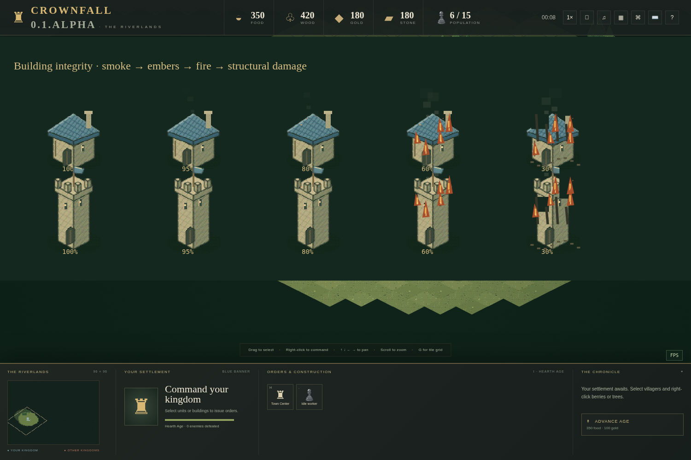

# On'Gate: Legacy 0.6.SilkRoad: orders and settings

Start with the [illustrated player guide](FIELD_GUIDE.md) for a visual walkthrough.

Current update: [SilkRoad construction, Gates, art, age rules and WebRTC browser rooms](SILKROAD.md).

See [ECONOMY.md](ECONOMY.md) for paid repairs, Blacksmith/School research, action categories, three-age artwork and map resources.

All packages use the same C++ rules, browser renderer and default settings. Windows does not have a separate gameplay implementation. The public version comes from `engine/version.h`; it appears in the interface, server API, startup text, Windows file properties and package build information. CMake's numeric project version is `0.6.0` because its version field accepts numbers; the public release is **0.6.SilkRoad**.

## Select and command

Click a unit, drag a box around your units, or Shift-click to add/remove units from selection. Right-click ground to move. Right-click berries, trees, gold, stone or your farm to gather with villagers; right-click your unfinished building to construct it. Right-click a hostile to attack. A selected worker's task target gets a gold outline and GATHER/BUILD label; attacks get a red ATTACK outline. Targets hidden by fog are not revealed by these overlays.

The command deck also has Move, Attack, Attack move, Patrol, Defend area, Hold ground and Stop buttons. Move travels without fighting en route. Attack move fights along the route. Patrol travels between the departure point and the chosen endpoint, engaging nearby enemies before continuing. Defend area fights near the departure point and returns after pursuit; its leash is six tiles. Hold ground attacks in range without chasing. Stop clears the current order and pending route; an idle soldier can still defend itself automatically.

## Rally flags, production and garrisons

Select a Town Center, barracks, range, stable or watchtower to see its RALLY flag. The Town Center’s default location is four grid coordinates forward on both axes; other production buildings use three, visibly below the building in the isometric view. Right-click ground with that building selected to move the flag. Right-click a visible resource to make newly trained villagers gather it automatically. Resources that run out stop being a rally task; later units move toward the flag instead.

Units leave through free ground near the structure, preferring the side facing the flag. Blocked exits wait rather than deleting a paid unit. Custom flags on unreachable ground use the movement system's closest reachable position. Flags and waypoint connectors show destinations, rather than a promise that the entire drawn straight line is walkable.

To shelter units, select them and right-click your completed Town Center or watchtower. Town Centers hold **10 units**, towers **10**, and Fortresses **20**. Units walk to the structure before entering. Garrisoned units count toward population, carry their existing load, and cannot be attacked or commanded separately. Select the structure and click **Deploy garrison** to release them toward its current rally flag. A Town Center's **Spawn inside** button makes newly trained villagers wait inside; full storage holds production until space is available. Towers shelter units but do not train them. Ranged occupants add arrows, capped at seven total; Town Centers also count villagers.

A destroyed tower, or a Town Center while another friendly Town Center survives, releases stored units onto nearby free ground. If no exit exists, those occupants die. Losing the kingdom's final Town Center eliminates all its entities.

## Queue a route with Shift

Select units and **Shift + right-click** successive ground destinations. Each click adds a flag. The units follow those destinations in order, pathfinding around obstacles. The selected formation's lead unit shows its active flag, numbered pending flags and dotted connectors. The server stores each unit's route separately, so formations can separate around obstructions.

A new ordinary order replaces the queue. Shift-clicking while gathering/building/defending/patrolling begins a movement route; it does not queue an economic task. Shift-clicking during move, attack move or a direct attack appends movement after that order. A unit can hold **16 pending waypoints** in addition to its active destination. The whole match reserves **16,384 pending nodes**. A rejected full-queue order leaves existing routes intact. An unreachable movement point finishes at the nearest reachable location before the next point begins.

## Keyboard settings

Open **⌨**, or press **Escape → Keyboard settings**. Click a binding and press the desired key combination. Conflicting bindings are rejected. Reset restores the shared defaults; import/export lets you carry a keyboard profile to another browser or computer. Profiles are validated before replacing your current settings.

| Default | Action |
|---|---|
| Four arrow keys | Pan map |
| Middle mouse drag / map edges | Pan map; edge pan can be disabled |
| Mouse wheel | Zoom at pointer |
| M / A / F | Choose move / attack / attack-move destination |
| P / D / V / S | Choose patrol destination / defend area / hold ground / stop |
| H / . / T | Select Town Center / next idle villager / train from selected production building |
| Shift+H / Shift+B / Shift+F | Place house / barracks / farm with selected villagers |
| Shift+A / Shift+T / Shift+S | Place range / tower / stable with selected villagers |
| G / Space / ? | Toggle tile grid / host pause / field guide |
| Ctrl+1…9 / 1…9 | Save / select a control group |
| Escape | Open game menu; close a submenu back to that menu |

Delete removes your selected units or opens building-razing confirmation. Escape and control-group digits are reserved. Browser/system shortcuts remain limited by the browser. Camera keys do not move the map while editing text or using modal settings. Pan speed and edge panning are configurable. Profiles, grid preference, audio volumes and difficulty preference are stored in that browser's local storage. Match selection, armies and control groups are not persistent save games. Export/import transfers keyboard and camera settings; it does not transfer audio settings or saved matches.

## Escape menu and surrender

Escape opens Resume, Keyboard settings, Game info, master/music/effects sliders, sound enable and Surrender. Opening the menu does **not** pause a LAN match. Solo/local operators can pause separately with Space or the pause button.

Surrender asks for confirmation. In solo or a local AI skirmish it ends the local session and returns to the main menu. Saved civilizations/maps and browser preferences survive. In LAN it eliminates your kingdom and leaves your tab watching your team's shared line of sight and explored terrain. You cannot command allies, select an enemy economy or turn your existing player token into a full-map spectator. If you have no living teammates, only explored terrain remains once fallen-unit sight grace expires; no enemy locations are granted. A surviving allied team shares victory.

The **four separately joined spectator seats** and the **dedicated host** intentionally retain full map vision. Defeated commanders remain in their original kingdom seats and do not consume those four observer seats. This is a trusted-LAN session model: it has no accounts preventing someone from opening a new browser and joining an available full observer seat.

## Animation

Units use a shared generated atlas: eight quiet breathing poses for all classes and sixteen-pose walking, attack and work cycles. Workers show tools only during work/combat. Feet advance with actual distance; pause freezes gameplay motion. Owner-dyed uniforms and building pennants keep kingdoms readable. [Monarch artwork](ART.md).

The renderer changes appearance only. Gathering and damage still happen on the authoritative C++ tick. The small roster uses left/right mirrored facing, rather than a full set of eight-direction models. See [ART.md](ART.md) for frame layout and [ENGINE.md](ENGINE.md) for the rule boundary.

## Deleting units, razing and damage

Select your units and press **Delete**, or click **Delete units**. They die immediately; their population slots and pending path nodes are released. This does not refund carried supplies or training cost. You can remap Delete in keyboard settings. Enemy/allied units cannot be deleted.

Select your buildings and click **Raze building** or press Delete. The dialog requires **two confirmations**: Continue, then Confirm — Raze buildings. Cancel or Escape leaves them intact. Razing a tower deploys stored units if an exit exists. Razing your final Town Center defeats your kingdom. Ownership and object-type rules are enforced by the native engine; the double confirmation is a browser interaction guard.

Unit death poses fall and leave a short-lived corpse. The server preserves the fallen unit’s sight circle for **at least five simulated seconds**, with up to one additional 0.25-second vision-refresh interval. Teammates share that grace. When it expires, normal fog returns wherever no surviving unit/building reveals the area; explored terrain stays remembered. Pause freezes the timer; game speed scales it. This applies to combat deaths and deletion, including units away from base. Stored units do not create a sight circle. At match end the final world snapshot freezes, as other match state does.

Building destruction uses collapse, rubble and dust. Completed buildings below full health show damage tiers: **90–99% smoke**, **70–89% embers**, **49–69% fire**, and **below 49% broken/burnt structural sections with fire**. These are visual effects driven by authoritative health; cosmetic fire does not add extra damage. Corpse/collapse effects have bounded storage and do not create simulation units.

Choose **Random civilization** on the welcome screen or in a human/AI lobby row for a surprise people at match start. Custom civilizations are included; restarting draws again. See [AI and random-civilization rules](AI.md#random-civilizations).

## Monarch council and Militia

**Host & Play** owns kingdom 1, while **Hosting Console** can reserve a dedicated operator instead. Capacity starts at two; raise it for more AI/friends. A guest can **Leave Lobby**; confirmed host leaving closes it for everyone. The council reserves unique banner colors. Feudal Footmen require the paid **Militia Drill** at an idle Barracks; aging alone does not upgrade them. Camera zoom spans 1×–2×. [Complete Monarch rules and modes](MONARCH.md).

## Expanded command ribbon

The bottom ribbon reserves more space for commands, buildings and upgrades. Its
action grid spans all space beside the minimap/selection panels, with two full
rows on desktop. Villager tabs are Commands, Economy and Military. On narrow
screens actions span the full bottom row; scroll inside that panel for additional
options. A reserved right gutter keeps economy/action tiles away from the panel edge and
scrollbar. Camera bounds track the actual ribbon size; panning stays local and sends no camera coordinates.

### Compact ribbon and restored camera

The ribbon now prioritizes the battlefield: 220 px high, 200 px on short displays,
and at most 260 px / 40% height on phones. Extra commands/buildings/upgrades scroll
inside their action panel. Resource-counter spacing stays intact. The older camera behavior is restored: the eight-tile viewport
clamp and forced centering are removed. Panning, dragging, zoom and minimap focus
behave as before that camera change. The main-menu camera remains locked.

The settlement selection panel is wider with more space between its portrait and
unit/building details, without increasing the compact ribbon’s height.

## Town Center defense

A completed Town Center has an eight-tile base weapon range (previously six).
Each living garrisoned Villager or ranged unit contributes one additional arrow,
up to seven arrows total, including the base arrow. Deploying or losing those
units removes their contribution. Villagers do not add arrows to other building
types; the existing ranged-unit bonus for Towers/Fortresses remains. Targeting
still requires hostile ownership and shared team vision.

## Movement recovery and victory reveal

A unit that keeps trying to walk but makes less than 0.15 tile of progress from
its recovery anchor for three simulated seconds is moved to the nearest safe
free tile within three tiles. Its ID, health, carried resources, current order
and queued destinations are preserved. Candidates must be in bounds, walkable,
currently team-visible, clear of live units and outside hostile attack range.
If none is safe, the unit waits and retries after one simulated second. Normal
work, idling and garrisoning do not trigger relocation. Pause freezes this timer.
Exceptional search work is limited to eight units per tick; large simultaneous
stalls can recover later than the three-second threshold.

Once a winner is declared, the whole playable map is revealed to all remaining
connections, including defeated commanders. During an unfinished match, defeated
commanders remain limited to team vision. Victory does not grant command
permissions, restart the simulation or reveal another kingdom's private wallet.
Out-of-map preview fog and the locked main-menu camera are unchanged.

## SilkRoad construction

Drag Wall placement to build a line. Gate placement uses three cells and **R** rotates it. Hold Shift while placing a foundation to append construction after the active task. Town Centers cannot be razed; other unfinished foundations refund half their original cost. At Castle Age, additional Town Centers add ten population each. Production portraits have cancel buttons; garrison portraits show occupants, who try to exit at 25% building health. See [full rules](SILKROAD.md).
