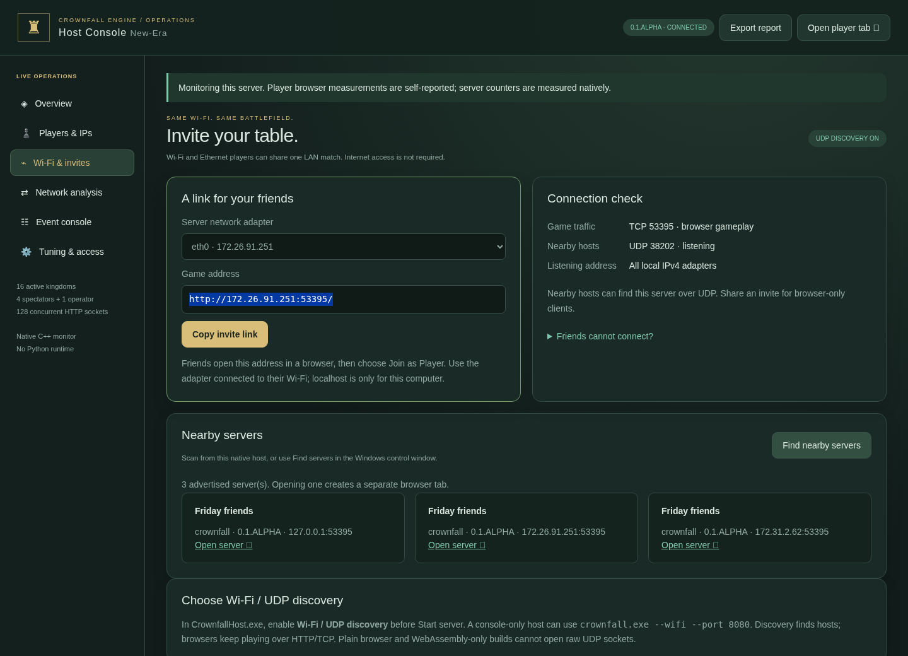

# Hosting On'Gate: Legacy 0.6.SilkRoad

Current update: [civilization architecture, spectator modes, age gates, 60 Hz tuning and platform policy](REALMS.md).


For the unified **Host & Play / Join as Player** menus, explicit leaving, banner
reservation and the two **localhost / server host** bindings, start with
[the complete Monarch multiplayer guide](MONARCH.md#localhost-and-server-host-modes).
The dedicated console below remains available for an operator who does not play.


No Ethernet cable or Internet connection is required once everyone has the game
or can open the host's browser page. Put the host and players on the same local
Wi-Fi, or mix Wi-Fi and Ethernet on the same router. A computer's existing mobile
hotspot can work if it permits connected devices to communicate. On'Gate: Legacy does
not create a hotspot or change your adapter/router settings.

## Start on Windows

1. Extract the **entire Windows ZIP** into a writable folder. Open
   **OnGate Legacy Server.cmd**, **OnGate Legacy Host Console.cmd** or **CrownfallHost.exe**.
   These now open the native Host Control window. No Python or terminal command
   is needed. Engine Studio also includes **Host a LAN game.cmd**.
2. Name the server. Choose **All local networks** for a normal home LAN, or choose
   the actual Wi-Fi/Ethernet IPv4 adapter. Avoid VPN/virtual adapters. Leave game
   **TCP 8080** and discovery **UDP 45855** unless those ports are occupied.
3. Keep **Wi-Fi / UDP discovery** checked to advertise in nearby-server scans.
   Click **Start server**. Wait for **Running**; bind errors appear in the output.
   Allow the executable through Windows Firewall on your trusted Private network.
4. **Host Console** opens the browser dashboard. Click **RESERVE HOST · 16 KINGDOMS**
   if requested. The native window controls the process; the browser operator
   controls the lobby and match. Reserving the operator does not add a kingdom.
5. Click **Copy invite**. Friends open that address in a browser on the same LAN,
   choose Join LAN, pick civilizations/teams and ready up. They do not need the
   native executable just to join. **Play locally** opens a separate player tab.
6. Add AI kingdoms in the dashboard or game lobby. Start becomes available when
   at least two opposing kingdoms exist and all humans are ready. The limit is
   **16 human/AI kingdoms + 4 observers + 1 operator**.

**Find servers** searches the selected UDP port for about 1.2 seconds. Select a
result and click **Join selected** to open it. You can find/join without starting
another host. Hosts and scanners must use the same discovery port. Two different
addresses for one machine can appear if it answers through multiple adapters.

**Save log** writes the native process output to a chosen file. Preferences live
in `data/host-launcher.json`; maps/civilizations remain in `data/content.json`.
Closing/stopping a running host asks for confirmation and ends its active match
and sessions. There is no live-match save. The window owns its server and scan
children; closing it also cleans them up. It never adopts or kills another host
already using a port. One launcher at a time is simplest.

If the window reports no LAN adapter, its `127.0.0.1` fallback works only on the
host itself. Connect Wi-Fi and restart the window, or use the actual IPv4 address
from `ipconfig`; do not share a localhost invite with other computers.

## Watch in a separate window

After creating a council with Host & Play or a dedicated operator, click **Spectate** in native Host Control or
**Open spectator window** in the browser Host Console. The viewer joins an
ordinary spectator seat automatically. The original console stays open with its
operator authorization. Terminal hosts also print a `/?seat=spectator` link.

The browser console requests a separate popup window. Allow pop-ups for the host
site if blocked. Native Host Control requests a new window from the default
Chrome/Edge/Firefox/Brave/Vivaldi/Opera browser; other registered handlers use
their normal window/tab behavior. No specific browser is forced.

This consumes **one of the four spectator seats**, never a kingdom or the
operator seat. It works in the lobby and after the match starts. A full observer
roster produces a clear error in the viewer; host controls keep working. Reload
resumes the same spectator token instead of allocating another seat. Closing a
viewer closes its live feed, but its lobby seat remains reserved until the host
kicks it. A reconnect after a network interruption uses the same seat.

Spectator windows have no opener and discard any copied host/Studio credentials.
They cannot issue orders, kick players, change settings or read private host
reports. Ordinary spectators see the whole map. Defeated commanders keep their
original player ID and team-limited fog; they never receive the omniscient feed.

### Receive-only updates and resource use

Native LAN spectators subscribe once to `/api/spectator-stream`, an authenticated
HTTP chunked NDJSON download. The server pushes up to **five updates per second**.
The shipped viewer makes **no recurring state polls, camera uploads, pings,
telemetry uploads or relay calls** after setup. Its camera and selection controls
are local. Debug information stays local too. Defeated commanders switch to a
separate fog-filtered push feed and resume player polling when a restart revives
them. The operator console has its own session and continues its management calls.

One shared world serialization serves all four ordinary spectators at each update;
team observers are serialized separately to protect vision/private data. Feed
storage is allocated only while needed. Each connection can hold one pending
JSON frame of at most 4 MiB; slow/stalled receivers are disconnected rather than
building an unlimited queue. Reconnects use a full baseline and back off from
one to ten seconds. No spectator adds AI, units, production or a new kingdom.

**Zero network upload packets is not possible with TCP.** Asset downloads, joining,
the initial subscription and reconnection require requests; TCP sends acknowledgements
and connection-control packets. The claim is zero recurring **application** uploads
on a healthy established viewer, not zero wire traffic, RAM or CPU. Spectators
still receive/parse snapshots and render the map/assets. Their FPS/ping columns
in host diagnostics are blank because automatic telemetry is disabled.

## The browser control room



`http://HOST-IP:8080/host.html` offers these tabs after operator authentication:

- **Overview:** tick cost, CPU, resident memory, traffic, pause, restart and lobby.
- **Wi-Fi & invites:** choose an advertised adapter, copy its browser invite,
  inspect TCP/UDP/bind state, scan nearby hosts and open safe source-address links.
- **Players:** search names/IPs/roles, see readiness, configure the map/capacity,
  add AI, start when ready and kick unwanted players. Live kicks eliminate that
  kingdom. Ordinary players cannot use the private management endpoints.
- **Network / tuning:** per-peer traffic, requests, latency reports, snapshot
  frequency and persistent IPv4 allow/block policy (128 addresses per list).
- **Events:** filter action/network events, freeze the displayed log and save
  exactly that visible text. Export report downloads the full diagnostic JSON.

Keep the operator tab: its token is stored in that tab's session storage. Another
browser does not automatically inherit it. Copy-invite works with the clipboard
API on localhost and falls back to normal text copying on ordinary LAN HTTP.
The dashboard is usable on narrow screens; larger tables scroll within panels.
The separate [diagnostics guide](DIAGNOSTICS.md) explains counters and tuning.

## What UDP wireless mode actually does

Wi-Fi is a link to your LAN, not a separate game protocol. **UDP discovery finds
hosts; browser gameplay still uses HTTP over TCP.** Browsers cannot open raw UDP
sockets. The native C++ server/scanner handles broadcast and returns nearby
addresses to the dashboard. A browser-only guest can always join a copied invite
without UDP discovery or any installed client. Static WebAssembly exports play
local AI or WebRTC browser rooms with manual invitations; it cannot host/scan native LAN TCP servers. See [SilkRoad browser rooms](SILKROAD.md).

UDP discovery is optional. If its port is occupied, the output/dashboard reports
that error while TCP gameplay continues. A failed scan does not prove the game
port is unreachable: use the invite directly. If TCP bind fails, no game server
starts; choose a free port or stop the old instance you own.

There is no NAT traversal, router port forwarding, Internet matchmaking or
IPv6 discovery. Broadcast usually stays within one IPv4 subnet. Different VLANs,
guest networks and access-point isolation can block discovery or all peer access.
VPNs can route traffic through the wrong adapter. Select the actual LAN adapter
or disconnect the VPN for this local workflow if appropriate.

## Firewall and hardware limits

An Ethernet **socket on the computer/router** is different from a TCP/UDP **port
number in software**. One physical socket or Wi-Fi adapter can serve many players;
you do not need a socket per player. Choosing TCP 9090 instead of 8080 does not
increase bandwidth or bypass a router's device/client limit.

For the host on a trusted Windows Private network, permit inbound **TCP 8080**
(or your game port) for browser play and **UDP 45855** (or your discovery port) for
advertisements. Use Windows Security → Firewall → Allow an app, or ask the network
administrator for rules limited to your local subnet. Scanner replies return to
an ephemeral UDP port; restrictive firewalls may also need an app rule for the
scanner. Linux firewalls require the equivalent rules. Do not turn the firewall
off. No Internet-router port forwarding is needed for same-LAN play.

Hardware and network configuration can limit a game night:

| Limit | What it changes / what to check |
|---|---|
| Router/AP maximum clients or small DHCP pool | Devices may fail to join Wi-Fi or obtain an IP. Check the router's documented client count and DHCP leases. |
| Guest/AP/client isolation | Players may all have Internet but cannot reach the host. Use a trusted LAN that permits device-to-device traffic. |
| Weak signal, congested channel, old 2.4 GHz radio | Packet loss and jitter cause retries and delayed orders. Move closer, reduce competing transfers, prefer a reliable 5/6 GHz link if supported. |
| Host adapter/AP throughput and airtime | Traffic is shared among players; a 100 Mb/s link or busy radio can bottleneck. Wired host + Wi-Fi players often helps. |
| Host CPU and browser rendering | Simulation/tick cost and graphics can limit play before the network saturates. Watch tick time, FPS and command latency; lower snapshot frequency if necessary. |
| Firewall, VLAN, VPN or managed network | Software policy may block the selected ports regardless of hardware. Direct-IP and UDP discovery have separate reachability. |

The implementation has **128 simultaneous HTTP connection slots**; these are
short-lived TCP requests, not 128 supported kingdoms. The gameplay seat limit
remains 16. No particular router, 16-device Wi-Fi latency or 100+ FPS is guaranteed.
Development checks cover real loopback UDP/TCP, malformed replies, permissions,
busy ports, Chromium UI and Windows execution under Wine. Physical Windows and
multi-device Wi-Fi should be checked on your actual network.

## Minimal native window and friendly web console

Both interfaces ship together: **CrownfallHost.exe** owns the server process and
its **Host Console** button opens the included web dashboard. Use the desktop
window for network/ports, start/stop, invites, play/spectate, saved logs and nearby
servers. It keeps a minimal design with plain controls and two output panes.
Controls and labels resize together; Windows DPI changes update fonts/layout.
Closing it stops only its own server.

In the web dashboard, **Overview** has three task shortcuts: **Set up your match**
(players, AI, map and readiness), **Invite friends** (LAN/Wi-Fi link), and
**Check activity** (filter/save logs). The side navigation becomes a horizontally
scrollable bar in narrow windows. Tables scroll inside panels. The same six
sections and host permissions work on all screen sizes. Use **Host & play from
the game menu** if the dedicated operator role is not what you want.

## Native terminal / automation (legacy Unix development)

Windows hosts can pass the equivalent flags to `crownfall.exe`. The Unix commands below are for source development or archived Linux builds; Linux releases are retired:

```sh
./crownfall --web web --data data --port 8080 --wifi --server-name "Friday friends"
```

Windows terminal equivalent:

```bat
crownfall.exe --web web --data data --port 8080 --wifi --server-name "Friday friends"
```

Useful options:

| Option | Meaning |
|---|---|
| `--wifi` | Opt into UDP advertisements; direct-IP Wi-Fi play also works without it. |
| `--bind 192.168.1.20` | Bind TCP to this host adapter; discovery accepts its subnet. Default `0.0.0.0` listens on all local IPv4 adapters. |
| `--port 9090` | Change game/browser TCP port. |
| `--discovery-port 45856` | Change discovery UDP port on **both host and scanner**. |
| `--server-name "My table"` | Public discovery label, bounded to 64 UTF-8 bytes. |
| `--discover` | Print scan results as JSON and exit; no server/web assets needed. |
| `--discover-address 192.168.1.255` | Optional scan destination: local IPv4/subnet broadcast. Usually automatic interface broadcasts suffice. |

For example `crownfall.exe --discover --discovery-port 45855` finds advertised
hosts. On Windows, **OnGate Legacy Server.cmd with engine arguments** keeps the old
headless console workflow, e.g. `"OnGate Legacy Server.cmd" --port 9090 --wifi`.
`"OnGate Legacy Host Console.cmd" 9090` preselects that TCP port in the native window.
Ctrl+C stops a terminal host. Studio authoring stays loopback; `--studio --wifi`
is rejected so source editing is not exposed through this hosting option.

## Modifying the tools

- `engine/host_windows.cpp`: native Win32 controls, settings, process/log ownership.
- `engine/discovery.{h,cpp}`: nonblocking optional UDP responder/scanner.
- `engine/network.{h,cpp}`: IPv4 adapters, subnet prefixes and portable sockets.
- `engine/http.{h,cpp}`: bounded receive-only chunked streams and slow-peer cleanup.
- `engine/main.cpp`: CLI, discovery polling and the flushed `HOST_READY` marker.
- `games/crownfall/application.cpp`: operator-only `GET /api/lan` and
  `POST /api/lan?action=scan`; players/spectators cannot request scans.
- `web/host.{html,js}`, `web/tools.css`: dashboard layout and controls.
- CMake target `CrownfallHost` builds the portable Windows GUI. Windows On'Gate: Legacy
  exports include it when the matching template is installed with
  `scripts/prepare-exports.py --host path/to/CrownfallHost.exe`. Other game modules
  retain their own UI. Rebuild templates after native changes.

The version-1 wire query is 384 bytes: `CROWNFALL_DISCOVER/1 `, 32 lowercase hex
nonce characters, newline, then spaces. Replies are at most 384 bytes of JSON,
with protocol `crownfall-lan/1`, matching nonce, name/game/version and TCP port.
The scanner derives join URLs from the actual UDP source; it ignores supplied
URLs and invalid ports/nonces. It retains at most 32 results. Queries only receive
replies from private/link-local/loopback IPv4 peers, with 4 replies per peer and
32 globally per second. Each poll processes at most 16 received datagrams per
socket. Scans last about 1.2 seconds with a two-second cooldown. No session tokens,
player names, gameplay commands or filesystem paths are advertised. Discovery is
unauthenticated LAN information, not proof of a server's identity.

Run `make check`, `python3 tests/browser_host_spectator_test.py`, `python3 tests/browser_host_control_test.py`, and on a Windows
build `python tests/windows_host_control_test.py` (set `CROWNFALL_WINDOWS_BUILD`
if needed). The last test clicks the real window and checks owned-process cleanup,
including both CMD launchers, Unicode installation paths/names and Studio assets.
[Installation](INSTALL.md) · [Server/game rules](SERVER.md) · [Engine exports](EXPORTS.md).

Monarch prefers a real Wi-Fi/Ethernet address for automatic server-mode invites. Loopback remains the fallback when no LAN adapter exists, and the explicit localhost mode always shares a localhost address.

## Choosing map size

The game lobby and browser Host Console offer one **Map size** dropdown:
64×64 (default), 80×80, 96×96, 112×112 and 128×128. Select **Custom dimensions**
to reveal width/height fields for a rectangle, then apply the map settings.
The existing 48–128 custom dimension limits and authored-map rules remain.
Guests can view but cannot apply host-only settings.

## SilkRoad art and browser rooms

The native lobby/web dashboard has a **Building art** selector for Legacy or Silk-Road. Static Web builds now offer WebRTC rooms with manual invitation/answer exchanges; see [the setup and network limits](SILKROAD.md). Steam support is [preparation only](STEAMWORKS.md) until an App ID/SDK and native transport are configured.
