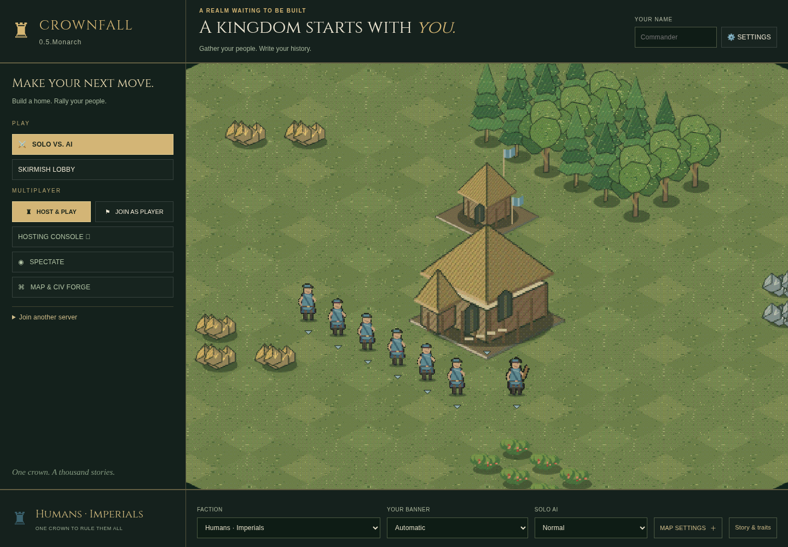

# Main menu · 0.5.Monarch

The owner’s reference defines the header, wider left navigation, animated
settlement and footer. The latest refinement restores sharp, compact boxes and
removes the oval fade. The main-menu preview uses default fog of war. The battlefield HUD and minimal native
Host Control keep their established layouts.

## Layout and settings

- **Top left:** ON'GATE: LEGACY, with the actual runtime version on the line below.
- **Header (left-aligned beside the logo):** “A REALM WAITING TO BE BUILT”, “A kingdom starts with *you.*”, and
  “Gather your people. Write your history.” Player name and Settings stay at right.
  The name is saved locally in this browser and never included in invite URLs.
- **Left rail:** “Make your next move.” introduces Play. Solo and skirmish (Watch AI vs AI is inside the lobby),
  side-by-side Host & Play / Join as Player, hosting console, spectator and forge
  remain reachable. Join another server expands an address field. WebAssembly
  hides native-only choices.
- **Center:** existing procedural pixel terrain, settlement, flags and breathing
  animation. Default fog of war frames this preview; no oval shadow, vignette or promotional/status captions cover it.
- **Bottom left:** selected faction crest/name and the crown tagline. Long custom
  names use an ellipsis with their full name in a tooltip.
- **Footer:** faction, banner, solo AI difficulty, Map Settings and Story & Traits.
  Choosing a faction changes the preview’s units and buildings immediately;
  banner selection recolors its cloth and flags. Custom peoples use their configured
  race. Random keeps its mystery crest and is resolved by the server at match start.

The large desktop frame uses a **340 px rail, 116 px header and 106 px footer**.
At medium widths, the story and footer gain rows. At 700 px and below, the menu
scrolls vertically with separate navigation, preview and footer sections. Labels
stay on one line; paired buttons and dropdowns have aligned 38 px controls.
Escape actions, including surrender and confirmations, share that square geometry.
Map/story popups have explicit Close buttons; outside clicks or Escape also close
open menu panels before opening Settings.

Every fresh match/host/map editor starts at **64×64**, with two kingdoms by default.
Choose 96×96, 128×128 or custom dimensions in Map Settings when needed. A joiner
uses the host’s existing settings; opening a console never resets an active map.

## Camera, isolation and startup

The menu camera keeps the settlement in view at a locked **1.7× zoom**. Arrow keys, middle dragging, scrolling and minimap
clicks cannot pan or zoom it. Joining restores normal 1–2× zoom and camera input;
leaving restores the selected cached preview and locked framing.

The renderer follows the preview section’s actual rectangle, including mobile
scrolling. Projection offsets and canvas clipping change only presentation.
The preview copies the public initial snapshot when a faction/banner changes;
it starts no second simulation, adds no polling and never modifies the original
snapshot or a live match. Real matches retain authoritative team fog and normal
vignette/camera behavior. Hidden menu minimap drawing is skipped.

Play buttons stay disabled until preview initialization finishes. Late replies
from departed seats cannot replace a new session or the menu. Solo surrender
returns to the same game path, including Web exports hosted in subdirectories.

## Graphics and maintenance

Open Settings or press Escape. Rendering defaults to 60 FPS; presets go through
200 and custom whole-number limits accept 1–1000. Achieved frame rate depends on
hardware/browser/display. Simulation and network tick rates do not change.

Markup lives in `web/index.html`; menu styling in `web/monarch.css`; preview
isolation/framing in `web/game.js`. `web/workshop.js` notifies the renderer after
content changes, including imported custom peoples. These same files ship in
Windows, Linux, Web and the Studio export templates.

`tests/browser_classic_ui_test.py` checks reference geometry, responsive controls,
preview race/banner changes, custom/Random choices, immutable source snapshot,
default preview fog, locked camera, startup gating, stale-seat recovery,
saved name and frame-rate scheduling/settings. Native lobby tests check 64×64
fresh defaults alongside existing explicit larger-map fixtures. Existing gameplay,
artwork, host and export checks cover the shared runtime.

Royal headings and the logo use bundled **Cinzel**, with its SIL Open Font License
in `web/fonts/Cinzel-OFL.txt`. It works offline; the middle story line is larger
than its eyebrow and supporting sentence.

Latest framing matches commit `2fc6e69`: locked 1.7× zoom, centered directly on
the Town Center with no additional pan offset. Preview
ground uses the preview snapshot’s default fog; simulation and
match/team fog data are untouched.

At the current **1.7×** zoom, decorative grass continues beyond the preview map
edge to fill every corner and border of the UI's preview rectangle. It uses the
same cached procedural tiles and is limited to presentation; playable map tiles,
map size, fog and camera limits remain unchanged. The cache stays bounded.

Tiles beyond the preview map are covered by opaque unexplored fog of war,
including the UI borders. The menu remains locked at 1.7× zoom.
