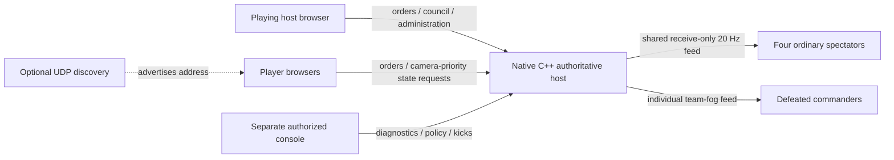

# On'Gate: Legacy 0.5.Monarch

Monarch unifies hosting, makes ownership readable and replaces elaborate idle
performances with quiet breathing. C++17 still owns the simulation and server;
JavaScript draws the interface. Python is optional development tooling only.

## Play, host and leave

The two main menu choices are **Host & Play** and **Join as Player**.

- **Host & Play** reserves kingdom 1 and gives that session host authority. The
  council starts with **two** kingdom seats. Increase capacity to add friends or
  more AI, up to sixteen active kingdoms. Choose a map and team, ready every human
  and start. The host also readies their own kingdom.
- **Join as Player** joins the server whose page you opened. To reach another
  computer, enter its HTTP(S) address and click **Open** first. Joining never
  uploads the existing host or Studio credentials to the other address.
- **Solo & local AI games** contains quick solo and a council for several AI.
- **Hosting Console** opens deeper timings, IP/seat management and logs. From a
  playing host, use the lobby button or Escape menu; the new console inherits
  that tab's authorized session. A normal player cannot gain host privileges by
  opening the console URL.
- For an operator who does not play, open native Host Control or `/host.html`
  and choose **Start Dedicated Lobby**. Players use separate tabs/computers.
  This retains the separate operator seat and four observer seats. The playing
  host and dedicated operator are alternative owners of the same lobby.
- **Leave Lobby** returns a guest to the main menu and releases their seat.
  A host who confirms leaving **closes the whole lobby**, revokes its tokens and
  returns connected clients to their menus. Escape offers leaving during play;
  a guest's kingdom is eliminated. **Surrender & Spectate Team** remains a
  separate option and keeps the original team-limited fog. A defeated playing
  host retains administration while their game view stays team-limited.

Leaving is an explicit action. Closing a browser tab does not reliably notify a
server and is not treated as a host departure: this preserves reload/reconnect.
Stopping the native server ends its process; disconnected browsers may show a
connection error until the server returns. An offline computer cannot remotely
close a lobby on a host it cannot reach.

## Localhost and server-host modes

Use the same small native C++ HTTP server in either mode. There is no Node,
Python gameplay server, relay service or extra runtime to install.

| Mode | Command from extracted Linux folder | Reachable clients |
|---|---|---|
| Localhost | `./crownfall --mode localhost --web web --data data` | Browsers on this computer, `http://127.0.0.1:8080` |
| Server host | `./crownfall --mode server --wifi --web web --data data` | Browsers on the same Wi-Fi/Ethernet LAN using the host's IPv4 address |

On Windows use `crownfall.exe` with the same arguments, or open **On'Gate: Legacy
Server.cmd**. Native Host Control's network selector offers **Server host**,
specific adapters and **Localhost only**. Localhost turns off Wi-Fi discovery;
server mode can use optional UDP discovery. Saved preferences retain the binding. Automatic LAN invites prefer a non-loopback
adapter; localhost remains available for local-only sessions.
**Host & Play** operates the selected server; it does not change its socket
binding from inside a browser. `GET /api/info` reports `networkMode`.

To host on one adapter use `--mode server --bind 192.168.1.20`. Localhost requires
127.0.0.1 and rejects conflicting binds or `--wifi`. Port changes use `--port
9090`. A custom loopback `--bind` can be used independently for development UDP
tests. Static WebAssembly exports run local AI in a worker; they cannot bind a
LAN listening socket. See [HOSTING.md](HOSTING.md) for firewall/AP/router limits.



| Route | Authority and purpose |
|---|---|
| `POST /api/join?mode=host-player` | Create a new LAN council and own playing kingdom 0 |
| `POST /api/join?mode=host` | Create a dedicated operator at seat 20 |
| `POST /api/join?mode=join` | Join an open kingdom before the start |
| `POST /api/lobby` | Self ready/civilization/color; host settings, AI and start |
| `POST /api/leave` | Release self; owner closes all sessions and the lobby |
| `POST /api/surrender` | Eliminate commander and keep team-fog observation |
| `POST /api/command` | Owned kingdom orders; server validates cost, age and targets |
| `GET /api/state` | Session-filtered baseline/delta and camera priority |
| `GET /api/spectator-stream` | Authorized native observer download, no routine uploads |
| `GET /api/diagnostics` | Host/Studio timings, CPU, memory, network and collision counts |

Sessions use the `X-Session` header. No token belongs in an invite URL. The
server preserves readiness, private resources and team fog; it does not trust a
client's color, role, age or unit ownership as authority. Ordinary spectators
share serialization; fallen commanders never receive their omniscient view.
TCP acknowledgements and setup/reconnect traffic are still necessary.

## Banners, units and buildings

Choose an unused banner in the main menu or your council row. Automatic reserves
a free color; another commander cannot take it. The host can set AI banners.
Changing a banner clears readiness. Colors survive roster compaction and match
restarts. Units, architecture accents, flags, selection markers, projectiles'
existing ownership markers and minimap indicators follow the owner; race and
skin remain independent. Death events retain the owner's color too.

All humanoids share one construction scale and a common eight-pose breathing
idle. Goblins, dwarves and hobbits are shorter. Mounts add their own anatomy.
Original ranger uniforms use practical tunics, collars, boots, bracers and braided
hair, rather than a traced reference costume/pose. Queen's Guards keep one active
weapon: bow at distance, sword in close combat. Workers have empty hands at rest
and while walking; tools appear during work or combat. Building cloth moves
locally, including small farm/wall pennants, without simulation/network entities.

Footmen remain Footmen when you reach Feudal. Select a completed **Barracks** and
research **Militia Drill** while that Barracks has an empty queue: 100 food, 50 gold, 20 simulation seconds. It upgrades
that kingdom's existing Footmen, preserving health percentage, and queued/future
recruits. The researching Barracks pauses recruiting; other Barracks can continue training. It is paid once per kingdom, available from age II, and cannot be
researched by Chaos Legion, whose ghoul/skeleton roster remains distinct.

The camera ranges from 1× to 2× magnification: the widest view spans twice the
width/height of the tightest view. The game removes the map-name overlay from
the upper-left battlefield. The minimap still identifies the map.

## Classic interface and minimal hosting controls

The owner’s reference defines the main menu: a top header, left navigation rail,
clear pixel settlement preview and bottom match-options bar. Player name and
Settings sit at the top right. The preview uses the existing procedural atlas,
flags and idle poses; its camera stays fixed at **1.7×**, slightly back from the
2× maximum. Menu arrow keys, middle-drag, minimap and wheel cannot move it.
Joining restores normal camera controls. [Layout notes and screenshot](MENU.md).
Thin gold rules, square-edged controls and the original battlefield command deck
remain. Host/join, color reservations,
explicit leaving and all Monarch game rules are retained. The map-name text stays
hidden. Controls use offline system fonts and visible keyboard focus outlines.

The Windows package contains **one** native Host Control launcher paired with
its web dashboard. The desktop window handles network/ports, start/stop, invite,
play/spectate, logs and nearby servers with plain controls and two resizable
output panes. All labels/buttons move together on resize; Windows DPI changes
rescale fonts and layout. **Host Console** opens the bundled browser dashboard
for player management, monitoring and access rules. No extra server application
or browser runtime is installed. The command-line server remains available for
Linux and Windows automation.

Web Console **Overview** provides direct tasks for match setup, invitations and
saved activity logs. Its navigation scrolls horizontally on narrow screens;
wide data tables scroll within their panels. All six sections remain available
on phone-width windows. See [the hosting guide](HOSTING.md).

## Legacy hardware and measured limits

**Escape → Rendering preset → Legacy dual-core** selects 30 FPS and 1× backing
pixels; Balanced selects 60 FPS/up to 1.5× pixels. High quality selects 200 FPS/up to
2× pixels. The separate frame-rate selector offers 30, 60, 90, 120, 144, 165 and
200 FPS, plus **Custom FPS** for whole numbers from 1–1000. New profiles default
to **60 FPS**. Valid earlier saved limits (including 240) are preserved as custom;
invalid or formerly uncapped values recover to 60. Invalid edits show an error
and keep the last valid limit. Choose **Settings** at the top right of the main menu,
or open Escape during play. Changing a rendering preset resets its suggested FPS;
a subsequent frame-rate choice overrides it. Settings stay
local and persist across reloads. Camera prioritization and bounded observer
feeds reduce serialization/traffic; there is no promise of zero RAM/CPU use.

The game uses baseline C++17/x64 builds without an AVX requirement. A 2010 CPU,
its operating system, browser and graphics driver have **not** been tested here.
Use two kingdoms and a small map first. Hardware acceleration is controlled by
the browser/driver; selecting a preset does not manufacture GPU support.

The actual RTS retains **8,192 entity slots** (including buildings/resources) and
120 population per kingdom. Production waits when full. Raising a constant to
one million would multiply entity and per-viewer storage and would not make AI,
pathfinding, fog, replication or drawing inexpensive.

The engine now has an independent **million-disc physics path**:

```sh
./crownfall --benchmark-physics 1000000
```

This headless benchmark reports JSON with time, contacts, candidate pairs, storage
and an identity checksum. `engine/crowd.h` uses structure-of-arrays storage,
preallocated linked cell lists, frozen positions during pair enumeration and a
swept closest-approach test. It has no per-cell population cap or dropped overflow
contacts. All body arrays have fixed equal lengths; IDs are stable. Modders can
edit initial positions/velocities, then call `step(dt)` with `0 < dt <= .1`.
Travel is limited per step; this is soft equal-radius crowd separation, not a
rigid-body siege/projectile engine. Non-finite coordinates and mismatched arrays
fail explicitly. Storage is roughly 30 MiB for the measured million-body layout. The final cloud
run measured **36.82 ms mean / 39.01 ms p95** for 1,000,000 bodies over 32 steps.
This is physics-buffer storage, not total process/browser RAM.

On'Gate: Legacy uses the same `spatial_grid.h` pair enumerator for unit separation.
It rebuilds buckets **after** movement and applies accumulated corrections after
all pairs are inspected. This prevents stale-cell misses and order-dependent
bucket mutation. `collisionPairs`/`collisionContacts` appear in host diagnostics.
Vision uses squared distances instead of repeated square roots. Simulation ticks
remain allocation-free in the 1,000-unit/2,500-house benchmark. Its final mean
ticks were **0.895 ms idle, 0.844 ms moving, 4.969 ms at a bridge**; the matching
previous milestone measured 1.369, 1.299 and 5.406 ms. See the JSON for all cases
and p95/max values; these are cloud measurements, not a 2010-dual-core guarantee.

A million physics bodies is **not a million fully simulated RTS units**. Dense
piles still have quadratic true contact counts; no algorithm can enumerate all
500 billion pairs cheaply. Full RTS, rendering, real Wi-Fi and 2010-hardware FPS
must be measured separately. [BENCHMARKS-MONARCH.json](BENCHMARKS-MONARCH.json)
records the final measured cases and their scope.

## Source and recovery

- `games/crownfall/application.cpp`: council ownership, colors, departure and HTTP roles.
- `games/crownfall/world.cpp`, `catalog.h`: Militia research and actual simulation.
- `engine/spatial_grid.h`, `crowd.h`: reusable broad phase and independent crowd physics.
- `web/art.js`, `motion.js`, `damage.js`: procedural pixels and client-only animation.
- `web/monarch.css`: shared readable fantasy skin over game/tool layouts.
- `engine/host_windows.cpp`: portable native process owner and host window.

Run `make check`, the Monarch browser/art suites and platform/package checks
before distributing changes. [PROGRESS.md](PROGRESS.md) lists permanent recovery
milestones. Extract older packages into a separate folder; preserve existing
version tags and personal content. [STUDIO.md](STUDIO.md) explains editing and
exporting, and [INSTALL.md](INSTALL.md) installs the compiler/toolchain.

### Sharp menu follow-up

The wider rail, square 38 px controls and single-line labels refine the reference
layout. The header carries the realm/kingdom/history text; game name and version
stack at top left. Main-menu fog, oval fading and vignette are removed. Faction
and banner choices immediately change the local preview; custom peoples use
their configured race, while Random stays undecided. Live match fog is unchanged.
Fresh host, solo, skirmish and editor maps default to 64×64; larger/custom choices
remain available. Escape actions, including surrender, share one box geometry.
See [MENU.md](MENU.md) for responsive layout and preview isolation details.

The subsequent royal-heading refinement restores **default fog in the menu
preview**, removes its two captions, and left-aligns the three-line header beside
the logo. Cinzel is bundled under the SIL Open Font License for offline headings.
