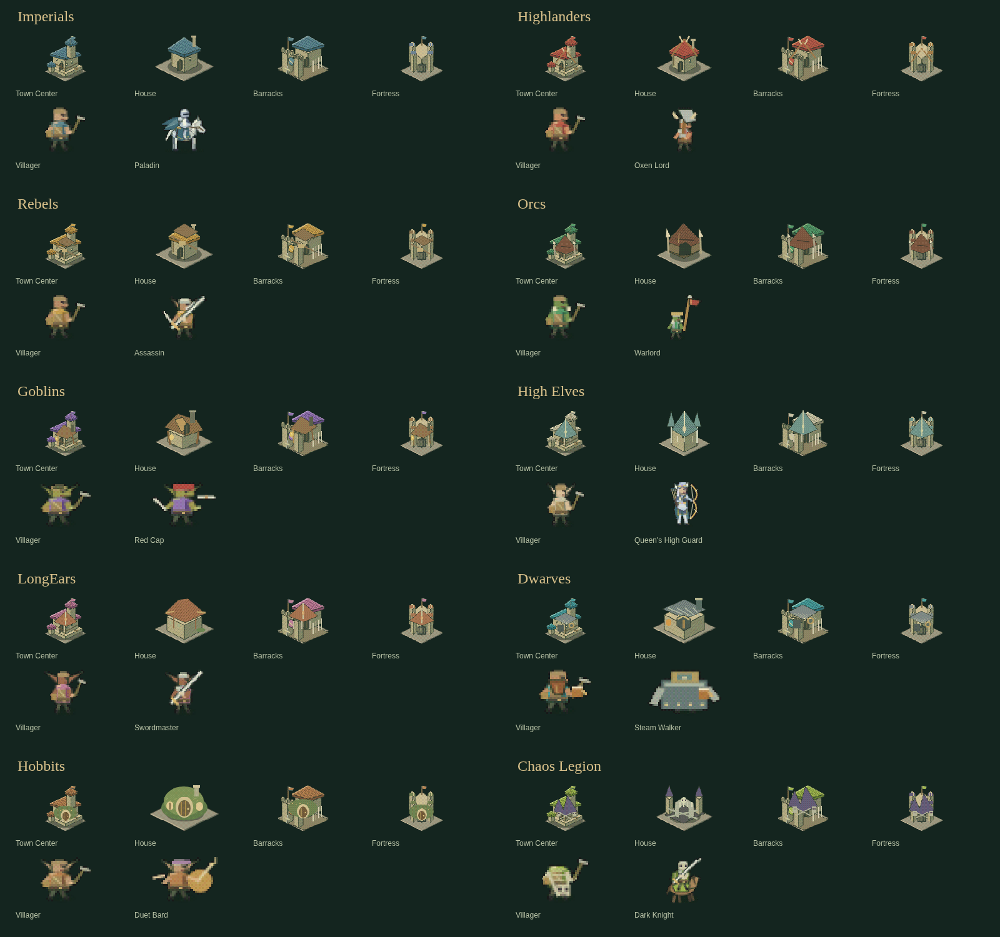
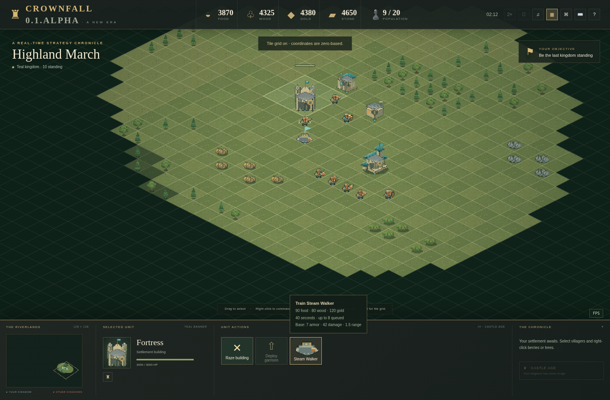

# A New Era — one crown to rule them all

**SilkRoad rules update:** Swordsmen now require Castle Swordsmanship after Feudal Militia Drill. Schools start Feudal. Building themes are selectable Legacy/Silk-Road; [current rules](SILKROAD.md) override older tables below.

On'Gate: Legacy now has **ten fantasy peoples**: three human factions and seven other races. Choose **People & Civilization** before joining a solo, local AI or LAN lobby. Open **Story & traits** for their background and numerical bonuses. The same choice is available for each AI kingdom. These are simulation rules shared by Windows, Linux, Web and Studio playtests.

## The broken crown

An imperial crown once held the river crossings, mountain roads and ancient woodland under one charter. Its breaking drowned the capital, opened the sealed battlefields and scattered its peoples. The survivors disagree about whether the next crown should rebuild the old order, protect the frontier or end the living world entirely.

| People | History and way of life | Strengths and costs | Fortress unit |
|---|---|---|---|
| Humans · Imperials | Charter guilds rescued libraries from the sunken capital. Ordered workshops and slate-roof settlements replace the lost court. | +30% building, +25% training, +10% gathering; −10% health and attack. | **Paladin**: armoured cavalry, 3 base armour, divine halo. |
| Humans · Highlanders | Abandoned hill clans swore the Oxen Oath. Timber halls, horn gables and fierce weapons keep their passes free. | +10% health, +18% attack; −5% gathering/building/training. No archery range; spearmen throw spears. | **Oxen Lord**: a durable axe thrower. |
| Humans · Rebels | Human, LongEar and other refugees founded the Free Hearths outside the imperial gates. They borrow tools and tactics from their neighbours. | +5% movement, gathering, construction and training; balanced combat. Dualists, knights and visible LongEar heritage among knife fighters and bowkeepers. | **Assassin**: fast, fragile, high damage infantry with two blades. |
| Orcs | Ash March clans follow ancestral migration paths. Hide halls, tusk posts, war hogs and their Warlords bind the clans. | +20% health, +15% attack; −5% movement, −10% construction/training. Thrown spears and hog riders; no archery range. | **Warlord**: a spear fighter with a six-tile allied morale aura. |
| Goblins | Exiles from the mines built the Lantern Warrens from salvage. Stilt houses, patched roofs and lanterns hide crowded workshops. | −20% health, −5% attack; +18% movement, +15% gathering, +10% building, +20% training. | **Red Cap**: a very fast knife assassin in a red cap. |
| High Elves | The glasswood court remembers the first crown. Slender spires shelter careful artisans and disciplined bowkeepers. | −10% health; +15% attack, +5% movement, +10% gathering; −10% building/training. Women archers and Dualists. | **Queen’s High Guard**: bow and sword, with 50% more damage inside 1.8 tiles. |
| LongEars | Human and elven border families chose orchards and open roads over either ancestral throne. Long pointed ears, tan skin and practical timber homes mark their settlements. | −5% health; +15% movement, +12% gathering. Women archers and Dualists. | **Swordmaster**: a mobile swordsman with quick attacks. |
| Dwarves | The Furnace Holds sealed out Chaos, then returned with riveted stonework and machines. Braided miners and armoured hammerguards protect the forges. | +25% health, +8% attack, +15% gathering, +10% building; −20% movement, −15% training. Crossbows and hog riders. | **Steam Walker**: a dwarf-piloted mechanical warrior, 7 base armour, slow heavy strikes. |
| Hobbits | Descendants of elven and dwarven frontier families, the Hearthgrove folk keep gardens, burrow homes and both ancestors’ songs. | −15% health, −10% attack; +8% movement, +25% gathering, +10% building, +5% training. | **Duet Bard**: a lightly armed support musician with a six-tile allied morale aura. |
| Chaos Legion | The broken crown woke the buried legions. Ossuaries and black spires shelter scavenging ghouls, skeletal ranks and mounted revenants. | −15% health, +5% attack; −10% gathering, +10% building, +30% training. Ghouls replace opening footmen. | **Dark Knight**: heavy skeletal cavalry. |

Bonuses multiply a unit’s base statistics. Research bonuses apply in addition. Their stories are also stored in the editable civilization data; they are not merely text in this guide.

## Military production

Select a production building to see its people’s legal roster. Unavailable ages remain visible but disabled. Prices, production time and combat values appear in tooltips. **T** queues the first unlocked unit; click a particular icon to select another. Production queues still hold eight entries. All units support movement, Shift routes, attack, patrol, hold, defend, deletion, garrisons and the existing fog/death rules.

| Structure | Dark Age | Feudal Age and later |
|---|---|---|
| Barracks | **Footman**, a single club/stick fighter. Chaos instead trains **Ghouls**. | **Swordsman**, **Spearman**; Rebels/Goblins/High Elves/LongEars add **Dualists**; Highlanders/Orcs add **Berserkers**; Dwarves add **Hammerguards**. Chaos trains **Skeleton Warriors** and keeps Ghouls. |
| Archery Range | — | **Archers**, with women bowkeepers for both elven peoples. Dwarves use **Crossbowmen**; Chaos uses **Skeleton Archers**. Highlanders and Orcs cannot build this structure. |
| Stable | — | **Scout**, low attack and fast travel. Orcs, Goblins and Dwarves use **Hog Riders** instead of scouts or knights. Only Imperials and Rebels add **Knights** in Castle Age. |
| Fortress | — | Castle Age only: the one unique champion listed above for the chosen people. |

Dualists have 70 base HP, speed 2.6 and fast attacks but no base armour. Berserkers hit for 26 with speed 1.4 and no base armour. Hammerguards have 185 HP, 5 base armour and a slow 2.2-second attack. Crossbowmen hit for 23, range 3.8 and reload every 2.5 seconds. Armour reduces damage to a minimum of one; forging and armour research apply to all military classes. Spearmen retain their cavalry bonus, including against hog riders. Highlander/Orc spearmen have 4.5 range instead of a melee-only weapon.

## Fortress, garrisons and morale

Build a **Fortress** in **Military buildings** after reaching Castle Age. It costs **300 wood, 100 gold and 350 stone**, takes **65 simulated seconds** before civilization modifiers, has **2,400 base HP**, occupies **3 × 3 tiles** and shelters **20 units**. It defends itself and trains its people’s champion. Right-click sets its rally flag; **Deploy garrison** releases stored troops. Use **Shift+C** to place one, or remap the shortcut in Controls. **Shift+W** places a one-tile wall.

Town Centers shelter 10 units and towers now shelter 10. A Town Center, Watchtower or Fortress fires one base projectile. Each garrisoned ranged unit adds one, up to **seven total**. Villagers and melee units provide shelter benefits without adding projectiles. Highlander/Orc throwing spearmen, elves’ High Guards, Oxen Lords, crossbowmen and skeleton archers all qualify. Volley count and damage are authoritative on the server; seven displayed projectiles correspond to seven base hits at that firing interval. Only one target is attacked per volley.

A living, deployed **Warlord** or **Duet Bard** gives nearby allied mobile units **+12% movement and +10% attack damage** within six tiles. Team alliances count, so a Hobbit player can support a friend’s Orc army. Multiple supporters do not multiply the bonus. The effect ends outside the radius, on the supporter’s death, or when it enters a building. Morale currently means those two numerical effects; it does not automatically retreat troops.

## Civilization design and future updates

Open **Workshop → Civilizations** or the independent Engine Studio’s civilization designer. A custom civilization has an explicit **Race template**, controlling its roster and procedural appearance. Change the template to try another people. **Use race story & bonuses** copies that template’s history and six economy/combat multipliers while keeping your custom name and stable ID. Tune sliders and starting resources, preview any of the three ages, save, then select it for a new match. Export important content as JSON before installing an update.

Older civilization JSON without `race` inherits `imperials`. Old `riverborn`, `oakwardens` and `ironvale` IDs still resolve for compatibility, while new pickers show the ten peoples. Resource IDs 11–14 remain stable; new kinds are appended. A new file can use `"race": "dwarves"`, for example. Unknown race IDs are rejected by the server.

Implementation points:

- `games/crownfall/catalog.h`: all prices, age gates, armour, footprints and combat statistics. Forty stable kinds, including 25 mobile kinds.
- `games/crownfall/races.h`: ten stories, default multipliers, roster/building restrictions, production structures, ranged classifications and unique champions.
- `games/crownfall/world.*`: simulation, morale, volleys, AI planning, production and fog-safe snapshots.
- `web/art.js`: the only art generator; `raceTemplates`, `raceHouse`, `raceBuilding`, `unit`, packing and bounds fitting. Update its roster when adding a native unit to a race. Regenerate the one `atlas.png`.
- `web/game.js`: catalog-driven production icons and tooltips; `web/workshop.js` authors race-linked civilizations.

The generic engine’s other game module, Orbit, stays independent of these On'Gate: Legacy rules. Rebuild Windows, Linux and Web runtime templates after C++ edits, then export through Studio. Browser/content edits export directly. See [EXPORTS.md](EXPORTS.md), [NEW_GAMES.md](NEW_GAMES.md), [ART.md](ART.md) and [GRID.md](GRID.md).

Screenshots from earlier milestones illustrate the editor/roster layouts; the current Monarch uniforms and shared idle are shown in [ART.md](ART.md).
