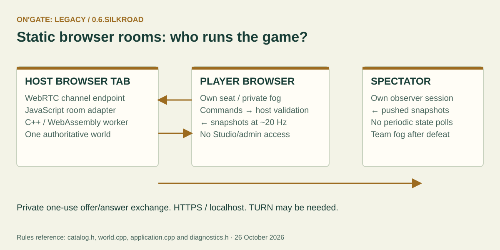

# On'Gate: Legacy 0.6 SilkRoad

SilkRoad adds construction queues, connected defenses, clearer production and
browser rooms while keeping the same authoritative C++ simulation. Windows and
Web share gameplay source. This guide takes precedence over older Monarch notes.

## Play the new rules

| Feature | How to use it |
|---|---|
| Advance ages | Click **Advance** after meeting the completed-building requirements. Selection is irrelevant. Dark → Feudal needs a Barracks; Castle needs two distinct types among School, Blacksmith and Archery Range. |
| School | Build from Feudal Age. Its first research levels are Feudal, second levels Castle. |
| Infantry upgrades | Research Militia Drill in a Feudal Barracks. Standard Swordsmen train directly in Castle Age; Swordsmanship research is retired. Existing Militia are not automatically converted. No Feudal standard Swordsmen. |
| Additional Town Centers | Castle villagers can build them. Each adds ten population support. Losing one does not defeat you if another survives. Town Centers cannot be razed, including foundations. |
| Wall line | Select villagers, choose Wall, hold the left mouse button and drag, then release. A stroke places up to 17 affordable segments. Obstructed cells are skipped. Repeat for longer lines. |
| Gate | Choose Gate, press **R** to cycle East/South/West/North, then place. It occupies exactly three cells, horizontally or vertically. It can replace your walls, never enemy walls. Completed gates admit allies and block enemies. There is no manual lock toggle. |
| Queue construction | Hold **Shift** when placing another foundation. Its cost is paid immediately. The workers finish their active build/movement job and visit queued foundations in order. Up to 16 pending jobs share the existing bounded waypoint pool. |
| Cancel construction | Raze an unfinished non-Town-Center foundation with the usual two confirmations: 50% of its original resource price returns. Completed buildings give no raze refund. |
| Cancel a recruit | Select its production building and click the portrait's **×**. The paid recruit cost returns; canceling the active recruit loses its training progress. |
| Garrison | Portraits show sheltered occupants. At 25% building health or below, occupants attempt an emergency exit around it; blocked exits retry when space becomes safe. |
| Move out of combat | A direct move order replaces combat and queued orders. Units do not choose fights en route. Attack-move still fights. |

**R while placing a Gate rotates it**; otherwise R retains Repair. Shift construction
and Shift-right-click movement share the per-unit queue limit. Canceling a foundation
clears it from future work by normal target validation; it does not duplicate refunds.

## Art and sound

Choose **Building art: Silk-Road / Legacy** in the native lobby or web host console.
The host reserves the choice for the room. Imperial architecture remains classic;
Silk-Road adds Viking timber Highlanders, weathered Rebels and distinct structures
for the other peoples. Towers keep one shared design and banner. Walls are tall,
modular and flag-free; Gates have four baked orientations. Owner colors, quiet
shared idles, tall trees and original uniform humanoid scale remain.

The generator uses polygons, lines, hatching and RGB Bayer dithering. Both themes
are baked as PNG atlases before release. `atlas-manifest.json` records their shared
layout and SHA-256 hashes. Runtime loads a PNG, never regenerates the full sheet
when a file is missing. The selected theme shares the existing bounded dye cache.
Changing art does not change occupancy or rules.

Attack poses now include a wind-up, strike and recovery. Nearby attack/gather
sounds play when zoomed in (at least 1.5×), on screen and enabled in audio settings.
Browser audio still requires a user gesture. A temporary **GATHER** label appears
above the scene; the minimap names the selected map. Production and garrison
portraits supplement the compact command ribbon.

## Browser rooms on a static website



Use HTTPS (or localhost) in a WebRTC-capable browser. Open **Host browser room**.
The hosting tab keeps the C++ world in a WebAssembly worker; keep that tab open and
foregrounded. Open **Room invitations**, create a one-use invitation and send it
privately to one friend. They choose **Join browser room**, paste it, choose Player
or Spectator and generate an answer. Paste that answer into the host's dialog.
Repeat with a fresh invitation per friend. Choose teams/AI/map and ready/start in
the normal lobby. Disconnect unwanted peers through the room dialog.

This is manual signaling: no account or signaling service is bundled. Codes contain
connection metadata; share them privately. Do not post TURN credentials publicly.

On permissive same-LAN networks, direct ICE candidates may be enough. Across routers
or restrictive browsers, both parties may need their own STUN/TURN configuration in
Advanced ICE settings, for example:

```json
[{"urls":"turn:your-relay.example:3478?transport=tcp","username":"your-user","credential":"your-short-lived-password"}]
```

No public relay is provided. TURN carries traffic and has bandwidth costs. A static
browser **cannot listen as an HTTP server at your bare IP**, and WebSocket requires
a reachable WebSocket server. The implemented static-site transport is WebRTC, not
WebSocket. Windows native hosting still supports direct reachable IP invitations;
Internet access to it requires deliberate routing/firewall configuration. Same
Wi-Fi may block peers through guest/client isolation. Closing the browser host ends
the room. Background-tab throttling can reduce its tick rate.

All commands are checked by the host's C++ rules. Each channel gets its own issued
seat token; remote headers cannot impersonate the owner. Studio/admin endpoints
are excluded. Messages/fragments, outstanding requests and slow-receiver buffers
are bounded. Ordinary spectators and defeated commanders receive pushed snapshots
at approximately 20 Hz without periodic client polling/pings/telemetry. This is not
zero network upload: setup, WebRTC control/ACK traffic and explicit actions remain.
Defeated commanders retain team fog; only victory reveals the whole playable map.

## Steam and performance limits

[Steamworks preparation](STEAMWORKS.md) explains the optional SDK adapter. No App ID
is configured. Steam invitations/relay gameplay are not operational in this build.

Rendering remains Canvas 2D with browser-selected acceleration, cached terrain and
PNG sprites. No new WebGPU/WebGL backend is claimed. Frame caps do not accelerate
the 20 Hz rules clock. There is no measured guarantee of 100 FPS, million-unit RTS
matches or smooth play on a 2010 dual-core CPU. The 8,192-slot RTS pool includes
buildings/resources; the separate million-disc benchmark is a different workload.

## Modding and recovery

Edit `games/crownfall/catalog.h` for costs/ages/technologies, `world.cpp` for legal
commands, `web/art.js` for generator geometry, and `web/game.js` for presentation.
Gate orientation travels in snapshots and commands; use `tileFootprint` for ground
rules instead of assuming every building is square. Construction queue entries
reuse the shared waypoint pool, tagged with a negative Y sentinel. Do not interpret
a build job's coordinate union as a movement position.

Regenerate both PNGs with `python3 scripts/generate_atlas.py`; rebuild C++ Windows and
WebAssembly for rule changes, refresh Studio templates, then export. See
[installation](INSTALL.md), [engine workflow](STUDIO.md), [exports](EXPORTS.md) and
[recovery milestones](PROGRESS.md). Keep old milestone tags and back up custom data.

Current AI commanders must scout bases before marching to them; see [AI scouting and memory](AI-SCOUTING.md).

### Gate placement pivot

Hover the first tile of the Gate. Ctrl + mouse-wheel steps rotate clockwise or
counterclockwise around that tile; R also rotates clockwise. Each orientation
occupies exactly three contiguous tiles (3×1 or1×3). A gold dot marks the fixed
first tile. While placing a Gate, Ctrl + scrolling rotates instead of zooming the camera; plain scrolling still zooms.
The preview, collision validation and submitted native center share that footprint.
Android has a ↻ Gate touch button. Completed Gates are not rotated in place.

Completed Gates now raise/lower an iron portcullis for nearby own/allied units
using nine baked poses per direction. Enemies do not trigger it, units inside
keep it open, and pause freezes it. Allied passage and enemy collision rules
remain authoritative. The Gate-only bake preserves all unrelated sprite pixels.
