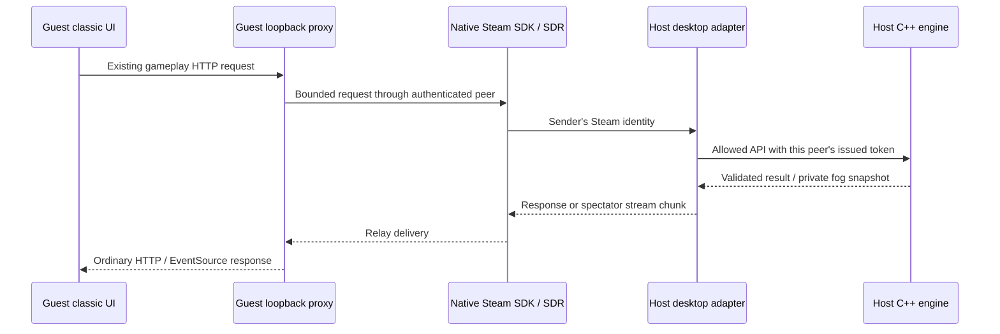

# Electron desktop: Steam App ID480 friend tests

This guide is for **OnGateDesktop.exe**, using the full classic Windows-x64/web
interface. The package includes `resources/game/OnGateSteam.exe`, Valve's
`steam_api64.dll` and `steam_appid.txt` containing480. The full developer SDK and
headers stay private; players need only the shipped runtime and a signed-in Steam
client. This is development mode while your production App ID is pending.

## Host and invite

1. Both friends install/extract the **same current Electron desktop build**.
   Complete its verified runtime preparation once. Start Steam, sign into separate
   accounts and add one another as friends. Keep Steam open.
2. Host launches OnGateDesktop.exe and selects **Host & Play** in the game.
   Configure map, civilizations, teams and AI in the normal lobby.
3. Press **Alt** to reveal the desktop menu, then **Steam480 → Host friends lobby**.
   A status dialog reports the decimal lobby ID after Steam creates the room.
4. Choose **Steam480 → Copy lobby ID** and share the ID with friends. A lobby ID
   is not a player/admin session token. No public IP, STUN or TURN code is needed.
5. Each friend copies that ID, opens the app, presses Alt and selects
   **Steam480 → Join lobby ID from clipboard**. After Steam connects, the same
   classic main menu appears through the local relay proxy. Click **Join as Player**.
6. Everyone readies in the normal game lobby; the host starts the match. Add AI
   with the existing controls for friends-versus-AI. Up to16 active kingdoms and
   four spectators share the20-member Steam room, including the playing host.

To watch, copy the ID and choose **Spectate lobby ID from clipboard**. It opens a
separate observer seat using the native receive-only event stream. Players retain
private/team vision; a remote peer cannot use an owner's token to become host.
One Steam connection owns one seat; use another account/device for another seat.

**Invite Steam friends** requests Steam's overlay invite dialog. Overlay display
and launch behavior are unverified in this sidecar/Electron configuration, so use
manual lobby IDs first. If Steam delivers an invitation callback, the desktop app
asks whether to join it. App480 is Valve's shared Spacewar test namespace: Steam
may show Spacewar or launch a different test app. It is not your production App ID.
Rooms are checked for `ongate_protocol=ongate-electron-http-1`; unrelated480 rooms
and the older Godot protocol are rejected.

## Leaving, connection issues and limits

**Steam480 → Leave Steam mode / local menu** closes the Steam connection and
returns to the app's own local server. Closing the host app disconnects everyone.
Local LAN mode continues to work independently and needs no Steam login.

- **SteamAPI_Init failed:** start/sign into the Windows Steam client, check that
  `steam_api64.dll` and480 text file remain beside OnGateSteam.exe, then retry.
- **No lobby ID:** first create the game's Host & Play lobby, then the Steam room.
  A pending SDK callback requires working Steam/backend access.
- **Wrong lobby/protocol:** both friends need this Electron build. The Godot
  native prototype uses a separate lobby protocol and is no longer maintained.
- **Connecting never finishes:** check Steam connectivity and account status.
  The adapter requests Steam Datagram Relay and disables direct ICE; Steam's
  authentication/relay backend must authorize the route. The SDK cannot guarantee
  every account/network combination. No inbound LAN port-forward is needed for
  this relay path, and the devices do not have to share Wi-Fi.
- **Game joins but action is rejected:** existing capacity/readiness/team/owner
  rules still apply. Guests cannot create/configure the host council or access
  Studio, admin controls or filesystem APIs through Steam.

Do not treat a successful build or local adapter test as a live-account test.
**Live Steam authentication, two-account relay, overlay and Internet performance
remain unverified here.** Test with a small room before increasing player counts.

## How it works



`engine/platform/steam_desktop.cpp` uses SDK1.65 matchmaking and
SteamNetworkingSockets. Friends-only membership authorizes accepted connections.
Payloads are limited to4MiB and fragmented into32KiB SDK messages. There are bounded
assembly/queue limits and expiry. `desktop/electron/steam.cjs` bounds requests,
rate/inflight counts and response queues, allows gameplay endpoints only, and
binds native session tokens to authenticated peers. It never trusts a client's
X-Session header. Tokens/addresses are not published in lobby metadata.

The Chromium page has no Node access, preload or privileged IPC bridge. Steam is
controlled through the native desktop menu. The simulation remains native C++;
camera coordinates are not transmitted. Spectators open a pushed native SSE feed;
they make no recurring application snapshot polls. Steam reliability/ACK/setup
traffic still exists. Players retain the engine's usual20Hz snapshot cadence.

## Rebuild the SDK bridge

Use the supplied private SDK root with Visual Studio2022/CMake:

```powershell
cmake -S . -B build/steam-desktop -A x64 -DONGATE_ELECTRON_DESKTOP=ON -DONGATE_STEAM_SDK=C:/private/steamworks/sdk -DBUILD_TESTING=OFF
cmake --build build/steam-desktop --config Release --target OnGateSteam OnGateProcessOwner --parallel 2
```

Pass the resulting executable/DLL to `scripts/package-desktop.py` with
`--steam-exe` and `--steam-runtime`. Public CI packages the checked-in SDK bridge
redistributable under `packaging/desktop/steam-runtime`, without exposing SDK
headers. Its SHA256 manifest must be regenerated whenever that binary changes.
The adapter's protocol is separate from Godot; preserve IDs and fog authority when
changing it. Once a real App ID is approved, replace the explicit480 initialization,
update the app file/build metadata and test entitlement/invitation/relay behavior
with the real app before release. No account secrets are embedded in this build.
