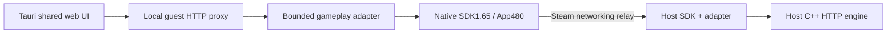

# Tauri Windows — sharing and testing with Steam App480

This guide applies to **OnGate-Legacy-Tauri-Windows-x64.zip**, not the retired
Godot/Win32 prototypes. Android uses local Wi-Fi/hotspot rooms and has no Steam
client/SDK mode. Steam480 is a development test identity (Spacewar), not your
production Steam App ID or a store release.

## Share the build

1. Both friends download the **same complete Tauri Windows ZIP** from this repo.
   Compare the adjacent SHA256 if troubleshooting. Extract the entire folder.
2. Keep `OnGateLegacyTauri.exe` and `tools/` together. `tools/` includes the supplied
   SDK's redistributable `steam_api64.dll`, `OnGateSteam.exe`, `steam_appid.txt`
   containing480, the shared gameplay relay adapter and its pinned Node runtime.
   The full private SDK is not included.
3. Install/update Steam on both Windows PCs, sign in to **different accounts**,
   go online, and add each other as friends. Both accounts must be able to run
   development App480. A family/shared account is not a second independent player.
4. Start Steam first, then run the Tauri EXE. You may add the EXE with Steam's
   **Games → Add a Non-Steam Game** for convenient launching. This shortcut alone
   does not enable lobbies; the SDK companion supplies App480 networking.

Steam may identify the development session as **Spacewar**. Do not change another
installed game's files or replace the ID with an App ID you do not control. A
future public release needs your approved App ID, Steamworks configuration and
normal distribution/signing work.

## Host

1. In the native menu choose **Connection / Steam480**, then **Host Steam lobby**.
2. The launcher displays a decimal Steam lobby ID. Share it privately with your
   friend through Steam chat or another channel. Only this game's matching
   protocol is accepted; other Spacewar games are rejected.
3. Choose **Open game**, then **Host & Play** in the unchanged game main menu.
   Configure teams, AI, civilization, map and capacity as usual.
4. Ask guests to join after that game council exists. Ready/start uses the normal
   lobby rules; the host still controls configuration and kicking.

## Guest or spectator

1. Choose **Connection / Steam480** in your own app.
2. Enter the host's decimal lobby ID, then choose **Join Steam lobby** or
   **Spectate Steam lobby**. Keep Steam online during connection.
3. After the SDK establishes the peer link, the app opens the same game UI through
   a loopback proxy. Players choose **Join as Player** and ready. Spectators receive
   the normal spectator route and pushed snapshots.
4. The host starts once everyone is ready. Keep both apps and Steam running.

This version uses manual lobby IDs. Steam overlay/invitation UI is not promised.
The native bridge may report an incoming invitation, but acceptance is explicit
through entering its lobby ID. Use the existing Electron build if you need its
separate native Steam menu while validating this Tauri wrapper.

## What actually runs

The Tauri launcher starts the existing `SteamDesktop` adapter verbatim from
`desktop/electron/steam.cjs` in a bundled, optional Node process. Its native SDK
sidecar uses friends-only20-member lobbies, matching protocol metadata and native
SteamNetworkingSockets with direct ICE disabled for relay testing. Tauri itself
still uses WebView2, not Electron. Node starts only for Steam mode; normal LAN/AI
play does not need it. On exiting Tauri, the owned companion's stdin closes,
which ends its server and native Steam process.

A random operator key protects the companion's loopback control API. Only the
bundled Tauri launcher receives it. Game pages and remote peers do not get native
IPC privileges. Peer-issued sessions stay in the host adapter; forged client
host-token headers cannot gain authority. Studio/admin/file/content-write APIs
are excluded. Payload, request concurrency, queue and timeout limits stay the
same as the tested Electron adapter. Spectator snapshot traffic is pushed; ACKs
and Steam control traffic still exist.

## Troubleshooting and limits

- **Steam initialization failed:** start Steam, check the account is online and
  App480 is available, and keep the DLL/AppID file next to `OnGateSteam.exe`.
- **Connecting times out:** verify the full matching build, lobby ID, friend
  relationship and that the host has opened Host & Play. Check VPN/firewall and
  Steam service status. No Google STUN/TURN URL is needed in this mode.
- **Same Wi-Fi?** Not required for Steam relay; both PCs normally need Internet.
  For offline hotspot play, use the LAN guide instead. Steam480 is not an offline
  relay and Android cannot join this SDK mode.
- **Return to game:** opens your local game route. To disconnect a Steam guest,
  leave its match or exit the app; returning to the local route alone does not
  close the transport. Restarting the local server ends connected local sessions.
- **No overlay:** manual lobby IDs remain the supported path. Adding a non-Steam
  shortcut does not guarantee overlay injection into the WebView/sidecar.

Cross-compilation, adapter tests and a successful Windows app build do **not**
prove live Steam login, friend invites or SDR connectivity. Two-account testing
on real Windows PCs is still required; record the builds, host/guest roles,
ready/start, gameplay, spectator flow and disconnect results when you test.
