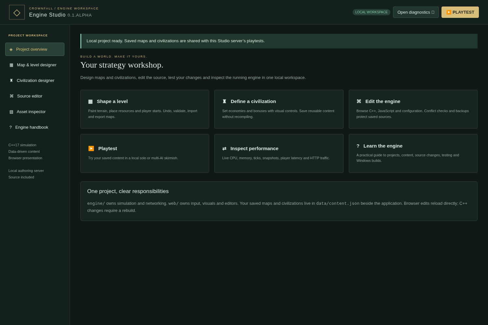
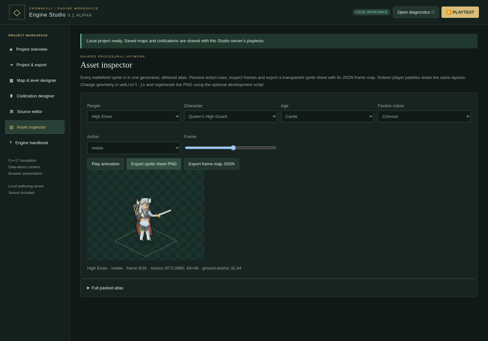

# On'Gate: Legacy Engine Studio · Windows authoring guide

Current update: [civilization architecture, spectator modes, age gates, 60 Hz tuning and platform policy](REALMS.md).


Engine Studio is a separate, portable Windows application for editing and testing On'Gate: Legacy projects. It includes the native C++ engine, its editable source, map/level and civilization designers, a source editor, playtesting, an asset inspector and live diagnostics. The application uses a local browser workspace; its Windows launcher owns the native server process.

## Open it

1. [Download the Engine Studio x64 ZIP](https://github.com/fiveft55/codex-rts-gametest/raw/refs/heads/main/downloads/windows/OnGate-Legacy-Engine-Windows-x64.zip).
2. Choose **Extract All**. Keep `CrownfallStudio.exe`, `crownfall.exe` and the entire `project/` folder together.
3. Double-click **CrownfallStudio.exe**, or **Start Engine Studio.cmd**. Its native window starts the authoring server on port **8088** and opens the Studio in your browser.
4. Leave the native window open. **Open Studio** reopens the browser. **Stop server** stops its engine; **Open project folder** opens the editable source directory. Choose another port if 8088 is occupied.

Python, Visual Studio and a compiler are not required to use the shipped application. Use Windows 10/11 x64 and a modern Edge, Chrome or Firefox browser. Back up both `data/` and edited `project/` files before updating the package. Extract an update into a new folder, then deliberately copy the content/source changes you want to keep.

Studio binds its authoring server to **127.0.0.1**, and source operations require its local browser authorization. The normal LAN game server does not expose source editing, even to a game host. Use the included **Host a LAN game.cmd** / **CrownfallHost.exe**, or the separate game package, when hosting friends. [Host Control guide](HOSTING.md).



## Projects and platform exports

Choose **Project & export** to set a game ID, title, version and module, then download **Windows x64**, **Web / WebAssembly**, or editable source. The shipped Studio includes both runtime templates. Content/browser edits export directly; C++ changes require rebuilt templates. Read [EXPORTS.md](EXPORTS.md) and [NEW_GAMES.md](NEW_GAMES.md) before creating a separate game.

## Make your first level

Choose **Map & level designer**. Set an ID, name, width, height and **2–16 player starts**. Dimensions are 48–128 tiles per side; 128×128 is recommended for a full 16-player match.

Paint grass, water, bridges or earth. Place trees, berries, gold and stone. Reposition player starts with the start brush. Use undo/redo, zoom and pan to refine the layout. Save the map, or export JSON to share it. The server checks terrain size, object coordinates, start clearance and start spacing before accepting it.

Click **Playtest**, open match options and select your saved map. For a local multi-AI match, use **Skirmish Lobby**, choose teams/civilizations/difficulties and ready up. A map needs enough starts for the chosen capacity. See [MAP_EDITOR.md](MAP_EDITOR.md).

The level designer currently authors terrain, resource objects and player starts. Campaign triggers, arbitrary prebuilt armies, cutscenes and visual scripting graphs are not implemented.

## Make a civilization

Choose **Civilization designer**, then **New civilization**. The preview age selector shows Dark, Feudal and Castle appearance. Give it a unique ID and display name, set starting resources, and adjust health, damage, movement, gathering, construction and training multipliers. Save or export it.

Your saved civilization appears in the playtest's civilization selection. Native C++ validates its ranges and applies the bonuses; a browser cannot grant itself a bonus through a gameplay command. Data-only civilization changes need no rebuild. Distinct unit families or new rules require source changes; see [MODDING.md](MODDING.md).

Maps and civilizations are stored in **`data/content.json` beside the Studio application**, not in browser storage. Studio editors and playtests on that server share the registry. Export designs before moving them to a different server.

## Edit source without losing your place

Choose **Source editor** and filter/select a project file. The editor supports line numbers, Tab indentation, Ctrl+S, reload, file export and syntax checks for JavaScript/JSON. The file tree includes the supported existing text files in the engine, games, web, docs, tests, scripts, packaging and CMake folders. Create new files using your ordinary file editor, then reload Studio to refresh the tree.

Saving checks the file's revision first. If another program changed it, Studio rejects the stale save and keeps your draft in the editor. Export that draft before reloading if you want both versions. Each successful save keeps the original in **`data/studio-backups/`**, retaining the latest 64 backups. File paths stay within the selected project; hidden files, parent paths and symbolic links cannot be edited through this API.

| Change | How it takes effect |
|---|---|
| Saved map/civilization | Available in the next playtest; a running match keeps its configured content |
| `project/web/*.js`, HTML or CSS | Reload the playtest / tool page using that file |
| `project/web/art.js` | Regenerate `atlas.png` with the optional art development script, then reload |
| `project/engine/*.cpp` or `.h` | Rebuild the native engine, replace the executable and restart |
| Live host policy | Applies when saved in Host Console; survives server restarts |

**Check syntax** parses JavaScript/JSON without running the edited code. C++ syntax and types are checked by the compiler. This is an editable source workspace, not a built-in C++ compiler, debugger with breakpoints, or automatic script-execution service.

## Rebuild C++ rules on Windows

Install **Visual Studio 2022 Community** or **Build Tools**, with **Desktop development with C++**, the x64 toolset, a Windows SDK and CMake tools. Open **Developer PowerShell for VS 2022** in the extracted `project/` directory:

```powershell
cmake -S . -B build/windows -G "Visual Studio 17 2022" -A x64
cmake --build build/windows --config Release --parallel 2
ctest --test-dir build/windows -C Release --output-on-failure
```

Python 3 is optional for source builds; installing it enables the HTTP integration tests. The C++ simulation test does not require Python.

Stop the authoring server using its native window. From that same `project/` terminal:

```powershell
Copy-Item build/windows/Release/crownfall.exe ../crownfall.exe -Force
```

Open Studio again. If you also changed `studio_windows.cpp`, close its native window before replacing `../CrownfallStudio.exe`. Rebuilding the simulation does not erase saved content, but restarting loses the current match.

To package your own Studio after building the normal Windows ZIP:

```powershell
python scripts/package-studio.py --game-zip dist/OnGate-Legacy-Windows-x64.zip --studio-exe build/windows/Release/CrownfallStudio.exe
```

The packaging script is a development tool. It creates `dist/OnGate-Legacy-Engine-Windows-x64.zip` and its SHA-256; players do not run that Python script.

## Inspect and tune

**Open diagnostics** launches an independent host console tab. It shows native process CPU and memory, simulation and serialization times, world counts, HTTP traffic, peer IPs, client-reported ping/FPS, administration events and tuning controls. Export a report while reproducing a problem. In a playtest, enable **Escape → Performance overlay** to see FPS, HTTP round trip, command acknowledgment and command-to-snapshot latency.

For LAN use, open the console from the operator game tab's Escape menu, or start **OnGate Legacy Host Console.cmd** from the game package. It supports **16 active kingdoms + 4 spectators + 1 host**, live kicking and up to 128 allowed/blocked IPv4 addresses per list. See [DIAGNOSTICS.md](DIAGNOSTICS.md).

## Where to change things

| File / folder | Responsibility |
|---|---|
| `games/crownfall/catalog.h` | Unit/building definitions, costs, ranges, speed and capacities |
| `games/crownfall/world.*` | Ticks, economy, movement, combat, death, team fog and state deltas |
| `engine/http.*`, `network.*` | Bounded nonblocking sockets and operating-system adapter |
| `engine/diagnostics.*` | Timing, process counters, live IP policy and bounded histories |
| `engine/project.*` | Local source authorization boundary, revision checks and backups |
| `web/game.js`, `controls.js` | Gameplay input, selection, commands and configured shortcuts |
| `web/motion.js`, `damage.js`, `art.js` | Walking/work poses, deaths, damage/fire and the single atlas |
| `web/host.*`, `studio.*`, `tools.css` | Standalone host / authoring interfaces |
| `web/perf.js` | Client overlay, counters and incremental-state merge |

The simulation, transport and resource counters are **C++17**. JavaScript handles Canvas, UI and browser input. Python is used for development tests, image generation and packaging only; there is no Python interpreter in the game, monitoring or networking hot paths.

## Other source platforms

The same browser Studio can run from a Linux source checkout:

```sh
make
./build/crownfall --studio --project . --web web --port 8088
```

Open `http://127.0.0.1:8088/studio.html`. The native process-owning `CrownfallStudio.exe` is Windows-specific. Linux native checks and Windows compatibility checks under Wine were performed in this cloud environment; real Windows desktop integration requires its platform checks. A configured CI workflow does not establish that a particular run succeeded.

## Current On'Gate: Legacy economy rules

The shared module now includes paid repairs, categorized villager construction, School/Blacksmith research, larger Town Centers, age artwork and neutral resource patches. See [ECONOMY.md](ECONOMY.md) for use and customization. All included runtime templates must be refreshed after C++ rule changes.

The fantasy race templates, military roster and Fortress rules are documented in [A New Era](NEW_ERA.md).

## Edit a unit animation

1. Open `project/web/art.js` in the source editor. `idleStyle(kind,race)` chooses a personality; `unit(...)` draws its body, equipment and gestures.
2. Keep its anatomy anchor consistent. Idle uses 24 frames; walk, attack and work use 16. Phase runs from zero up to one. The same procedure generates each supported race and legal age.
3. Regenerate the shared PNG using the optional development command `python3 scripts/generate_atlas.py` from the project folder. This requires Playwright and Chromium; the shipped game itself does not require Python.
4. Run `tests/art_bounds_test.py`, `tests/browser_animation_test.py` and `tests/browser_assets_test.py`. They check ground bounds, action poses, weapon switching and faction colours. Packed 64×48 unit rectangles have ground anchor `(32,44)`; buildings use 128×192 rectangles with ground anchor `(64,160)`. Use `CrownArt.drawFrame` or `blit` to preserve those anchors.
5. Reload the playtest. Sprite-only edits do not require recompiling C++; native snapshot-rule edits do. Rebuild/install runtime templates before exporting a C++ change.

Read [ART.md](ART.md) for source layout, memory and idle gestures, and [SNAPSHOTS.md](SNAPSHOTS.md) for the two camera boxes, default rates, diagnostics and engine extension points. The same edited game assets ship in all three platform exports.

## Inspect and export character sheets

Open **Asset inspector**. Select people, character, age and faction colour. Choose
an action, play/pause it, or scrub the frame slider. Export **sprite sheet PNG**
and **frame map JSON** together. Each transparent 64×64 cell has ground anchor
`(32,56)`; actions occupy separate rows, including the Queen's Guard's sword row.
The sheet is generated from the shipped atlas with your selected faction colours.
It is an editing/export artifact; the game continues to load one packed atlas.



See [PROGRESS.md](PROGRESS.md) for historical packages, permanent milestone tags
and safe recovery instructions. The repository's [AGENTS.md](../AGENTS.md)
preserves product decisions and the build/validation handoff for future sessions.

Monarch exports include the common eight-pose idle, original owner-dyed uniforms, animated building pennants, unified playing/dedicated-host lifecycle and Militia research. Sprite sheets use 16 columns of 64×64 cells. New generic collision/physics sources remain editable independently of the On'Gate: Legacy rules. [Monarch guide and honest scale limits](MONARCH.md).

Screenshots from earlier milestones illustrate the editor/roster layouts; the current Monarch uniforms and shared idle are shown in [ART.md](ART.md).
