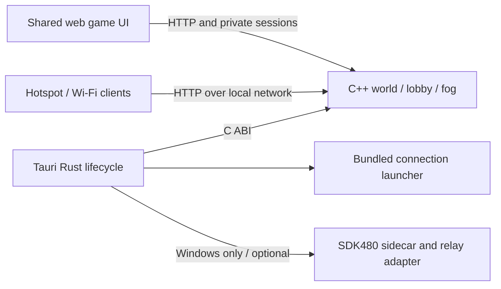

# On'Gate: Legacy — Tauri editions

Tauri v2 puts the existing HTML/CSS/Canvas game inside a native application
window. It uses Android System WebView on Android and Microsoft Edge WebView2 on
Windows. The same C++17 world, lobby, fog, commands and bounded HTTP transport
run in the app process through a small Rust/C++ bridge. This is not a Godot or
Win32 renderer rewrite. Electron remains available separately.

## Android: play or host over a hotspot

Install `OnGate-Legacy-Tauri-arm64.apk` from `downloads/android`. This development
APK supports ARM64 Android8/API26 or newer and a current Android System WebView.
Allow installation from the browser/file manager when Android asks. The new app
has a different package ID from the old Godot prototype; they can coexist.

1. On the host phone, enable a password-protected hotspot in Android settings.
   Alternatively, connect all devices to the same Wi-Fi router.
2. Open OnGate Legacy and choose **Host Wi-Fi / hotspot room**.
3. Copy one of the displayed room addresses, including its port. If several are
   listed, use the hotspot/Wi-Fi address, not a mobile-data/VPN address. Do not
   assume `192.168.43.1`: Android manufacturers use different hotspot subnets.
4. Choose **Open game**, then **Host & Play** in the familiar game menu. Configure
   the council, teams, AI, map and colors normally.
5. Friends connect to that hotspot, open their app, enter the address under
   **Join a friend's room**, and choose **Join as Player** in the game menu.
   Other devices can also open that HTTP address in a browser.
6. Everyone readies; the host starts. For a dedicated operator, open **server
   console** instead of the game and create/manage the council there.

The player and server are included in one APK. No computer, Node installation,
STUN, TURN, port forwarding or mobile-data subscription is needed for local
hotspot play. Multiplayer uses the normal HTTP/TCP transport, not WebRTC.
The operating system assigns an unused port; share the complete address shown.
The server binds all IPv4 interfaces only when **Host** is selected. Local play
binds loopback. Interfaces must exist before starting hosting.

**Keep the host app visible and the screen awake.** This first build is a
foreground host, not a persistent Android foreground service. Android may pause
or terminate background apps; switching apps, screen locking, battery restrictions
and thermal throttling can interrupt a match. The activity keeps the screen on
while visible. Closing/force-stopping the host disconnects everyone. Keep a charger
nearby for long games. Hotspot client limits and client isolation vary by phone;
the engine's16-player/4-spectator capacity does not override those hardware limits.
There is no automatic hotspot activation or background location permission.

If joining fails, check the address/port, hotspot connection, VPN and hotspot
client isolation. Disable cellular fallback for a guest if it leaves Wi-Fi with
no Internet. If interface enumeration shows no address, restart hosting after
turning the hotspot on; a guest's Wi-Fi gateway address can identify the host.
Only share room addresses with trusted players on your local network.

## Android controls

The shared web UI retains its fonts, colors, menus, economy bar, minimap and
command ribbon. Four edge arrows replace green lines. Arrow backgrounds are
transparent; glyphs are faint until pressed. Hold to pan; release/cancel stops
immediately. Physical screen-edge hover does nothing. The menu preview stays locked.

- Tap a friendly unit/building to select. Tap empty ground or a hostile/resource
  target with units selected to issue the usual contextual right-click order.
- **Auto / Select / Order** cycles touch intent. Use Order explicitly to repair
  a friendly structure, garrison, or set a rally point without selecting the target.
- Drag to box-select; when a wall is selected for construction, drag the wall line.
- **Queue** holds the equivalent of Shift for movement/build commands.
- **↻ Gate** rotates a Gate around its first tile while placing it. On Windows,
  hold Ctrl and scroll the wheel (or press R); the footprint remains exactly three tiles.
- Pinch or use **− / +** to zoom. Commander1–2× and spectator1–4× limits remain.
- **☰** opens the existing Escape menu. Cancelled touches/losing focus clear held
  controls. Collect remains first and Delete last; building deletion confirmation
  and all authoritative command rules stay in the shared implementation.

## Windows x64: tauri-windows

Download `downloads/tauri-windows/OnGate-Legacy-Tauri-Windows-x64.zip`, extract the
**entire folder**, and run **OnGateLegacyTauri.exe**. Keep `tools/` beside it.
The executable is AMD64/PE32+. Windows10 (1903+) or Windows11 x64 and **Microsoft Edge WebView2
Evergreen Runtime** are required. Most PCs already have WebView2; otherwise install
it from https://developer.microsoft.com/microsoft-edge/webview2/ .

The app opens the original game main menu immediately. The packaged `web/` source
files are byte-identical: no alternate desktop HUD, fonts, menu composition or
scene artwork. **Connection / Steam480** in the native menu opens connection
controls; **Return to game** returns to the local menu. The same viewport and
settings use the same responsive layout. WebView versions, display scaling and
GPU/font rasterization can produce pixel differences; no different design is used.
The game/server run inside the app process, and stop with it. Allow the EXE through
Windows Firewall on private networks for LAN hosting. The chosen port appears in
the connection controls. No separate native renderer work is resumed.

[Steam480 friend-test guide](STEAM480-TAURI.md). The optional Steam companion uses
the same native SDK bridge and unchanged, bounded HTTP/SSE adapter as Electron.
Its pinned Node24.11.1 runtime is bundled; it runs only after Steam mode is chosen.
No Node installation is required. Steam is Windows-only in these Tauri editions.

## Architecture and editing



- `mobile/tauri/src-tauri/src/lib.rs`: native commands, app lifecycle and startup.
- `mobile/tauri/native/server.cpp`: existing native HTTP engine hosted on one
  simulation thread with two bounded snapshot workers; orderly stop/join.
- `web/`: authoritative shared UI source. Edit here for design/gameplay changes.
- `scripts/prepare-tauri-android.py`: copies `web/`, adds Android touch code to
  the Android copy only. `--platform windows` stages it unchanged. The two copies
  use separate `web-assets/android` and `web-assets/windows` directories so parallel
  builds cannot exchange touch/desktop assets.
- `mobile/tauri/android-touch.*`: Android overlays and gesture adapter.
- `mobile/tauri/launcher/`: connection setup, not a replacement game menu.
- `mobile/tauri/src-tauri/gen/android/`: committed Android app/Gradle configuration.
  Do not regenerate it casually: cleartext local HTTP, landscape orientation and
  screen-awake behavior are intentional. Generated Rust Kotlin/JNI outputs and
  personal SDK paths are ignored.
- `scripts/prepare-tauri-windows.py`: exact UI and verified optional runtime staging.
- `scripts/package-tauri-windows.py`: AMD64/PE32+, source parity, ZIP/SHA checks.

Only the bundled launcher gets native IPC capabilities. HTTP game pages, including
remote servers, are not granted Tauri commands, filesystem or shell access.
The bridge embeds the existing bounded server; it does not expose arbitrary file
paths or execute user-supplied shell strings. Saved data stays in app-private data
and copied assets in app cache. Remote player sessions keep normal host/token/fog
checks. The full Steam SDK and signing keys are not distributed.

## Build from source

Install Node LTS/npm, Rust stable, Python3 and JDK21 **including javac**. Android
also needs Android SDK command-line tools, platform36, build-tools36.0.0 and
NDK27.2.12479018. Set `JAVA_HOME`, `ANDROID_HOME` and `NDK_HOME` to those installations.
Accept SDK licenses with `sdkmanager --licenses` and install ARM64 Rust support:

```sh
rustup target add aarch64-linux-android
npm ci --prefix mobile/tauri
python3 scripts/prepare-tauri-android.py
cd mobile/tauri
npx tauri android build --apk --target aarch64
```

Release APKs need signing before installation. Keep production signing keys
outside Git; use Android build-tools `zipalign` then `apksigner`. A locally signed
development APK is for sideload testing, not a Play Store release. Future updates
must use the same signing key or Android will require uninstalling first.

On Windows, install Visual Studio Build Tools with Desktop C++/Windows SDK:

```powershell
npm ci --prefix mobile/tauri
python scripts/prepare-tauri-windows.py
$env:RUSTFLAGS = '-C target-feature=+crt-static'
cd mobile/tauri
npx tauri build --no-bundle --target x86_64-pc-windows-msvc --config src-tauri/tauri.windows.conf.json
cd ../..
python scripts/package-tauri-windows.py
```

`.github/workflows/tauri-windows.yml` builds on actual Windows, verifies executable
architecture and source parity, starts the packaged native server, checks its HTTP
endpoints and shutdown, then publishes the ZIP/checksum if main has not changed.
The SDK sidecar in `packaging/desktop/steam-runtime` is reused, with its source/hash
manifest. Rebuild it only against your private licensed SDK if its source changes.

## Gate portcullis

Completed Gates raise their iron grille for own/allied units approaching or
occupying the three-tile passage, and lower after the passage clears. Nine baked
lift poses per direction live in the existing PNG atlas; the renderer does not
regenerate artwork or create simulation objects. Motion respects pause and uses
only entities present in the viewer's snapshot, so it cannot reveal hidden units.
Enemies never trigger opening; the existing authoritative allied-only passage
rule stays unchanged. A unit standing inside keeps the grille raised.

## Validation scope

Linux development integration tests cover the actual embedded C++ bridge with
LAN clients, readiness/start, private fog/wallets, spectator permissions, host-leave,
shutdown/restart, and real Chromium touch input. ARM64 compilation and signed APK
checks are separate from physical Android testing. Consult the milestone record
for actual Windows CI results. Physical hotspot devices, Android WebView GPU/touch
behavior and real Steam accounts/SDR remain unverified until recorded there.
